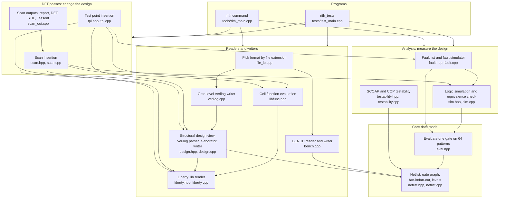
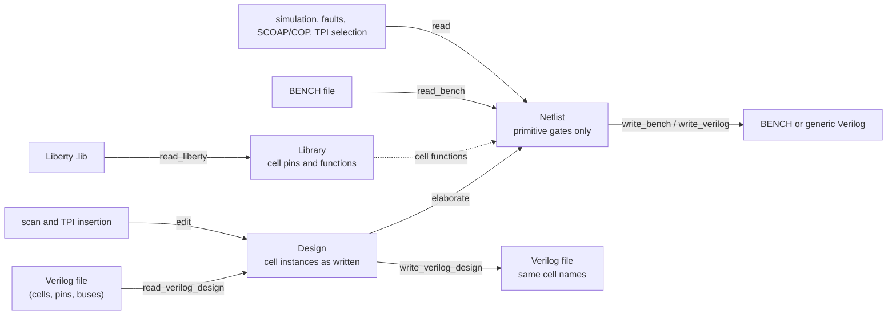
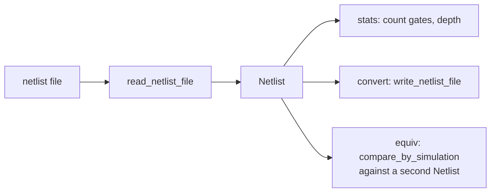
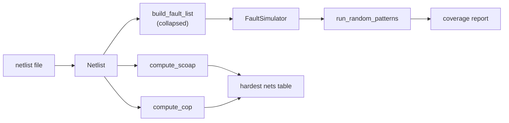
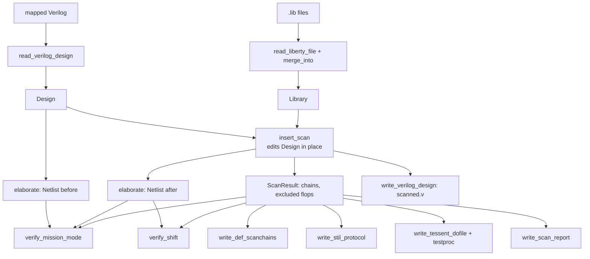
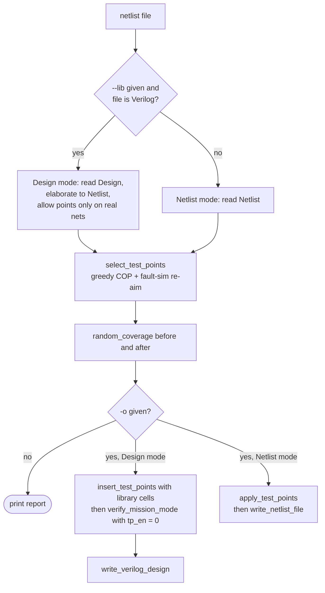
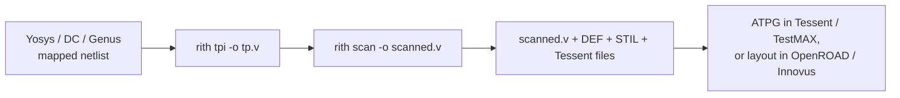
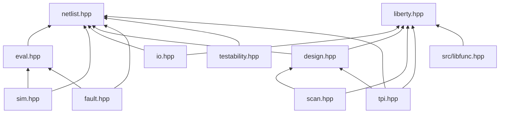
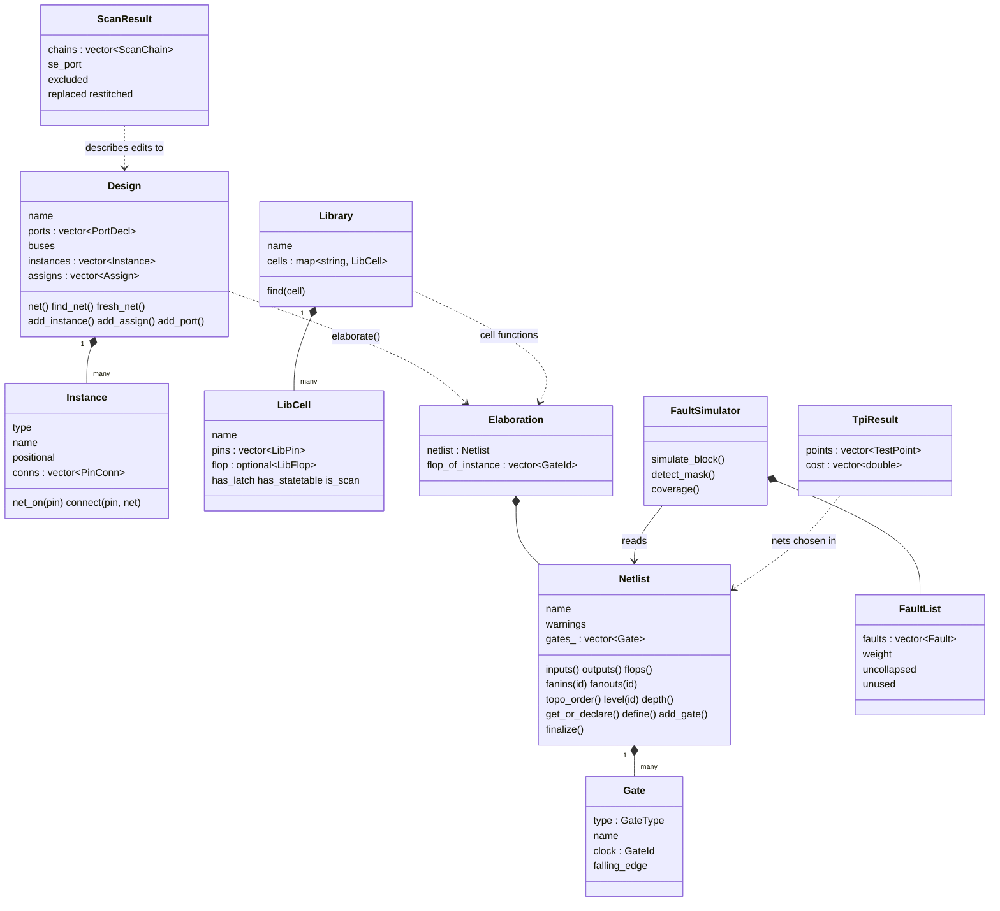

# Architecture

rithereal is a C++20 library (`rith_core`) plus one command-line program (`rith`)
and one test program (`rith_tests`). It has no outside dependencies apart from the
C++ standard library and threads.

The job of the tool is to take a gate-level netlist (from Yosys, Design Compiler,
Genus or an ISCAS benchmark file), analyse how testable it is, and add test
hardware to it (scan chains and test points), then write the netlist back out in a
form the commercial tools accept.

## Block diagram

The code is in layers. Each layer only uses the layers below it.

### Two views of one circuit

The most important idea in the code is that a circuit is held in two different ways.

- **`Design`** ([design.md](modules/design.md)) keeps the netlist exactly as the
  synthesis tool wrote it: library cell names, named pin connections, buses and
  `assign` statements. Passes that *change* the circuit (scan insertion, test point
  insertion) edit the `Design`, so the result goes straight back into Design
  Compiler, Genus, Tessent or OpenROAD with the same cell names.
- **`Netlist`** ([netlist.md](modules/netlist.md)) is a simple graph of primitive
  gates (AND, OR, NOT, XOR, MUX, DFF, ...). Every *analysis* (simulation, fault
  simulation, SCOAP/COP, choosing test points) runs on it, because primitive gates
  are fast and easy to reason about.
- **`elaborate()`** turns a `Design` into a `Netlist`. For each library cell it
  looks up the cell's Boolean function in the Liberty library and builds primitive
  gates for it. It also records which flop gate came from which instance, so a
  result found on the `Netlist` can be mapped back to the `Design`.

## How data flows through each command

### `rith stats`, `convert`, `equiv`

### `rith faultsim` and `rith testability`

### `rith scan`

### `rith tpi`

The normal full flow, as the README suggests, chains these commands:

## Header dependencies

Which public header includes which (from `#include` lines). `libfunc.hpp` is
private to `src/`.

## Main data structures

## Design rules that run through the code

- **Gate IDs, not pointers.** Gates are numbered (`GateId`, a 32-bit integer) and
  every per-gate value (simulation words, SCOAP numbers, COP probabilities) is a
  plain `std::vector` indexed by that number. This is fast and easy to copy.
- **Build, then freeze.** A `Netlist` is built with `define()` calls and then
  `finalize()` packs the connections into compact arrays (CSR) and computes the
  level order. After that it is read-only.
- **Full-scan view everywhere.** Analysis treats each flop's Q as an input and its
  D as an output. This is what scan hardware gives the tester, and it keeps the
  algorithms combinational.
- **Check by simulation.** Every change to a design is checked with random
  simulation: mission mode must be unchanged, scan chains must shift correctly.
  These are strong checks but not formal proofs.
- **Match cells by function, not by name.** Liberty cell functions are evaluated
  by truth table (`libfunc.hpp`), so the tool works with any library (SAED32,
  Sky130, commercial) without a table of cell names.
