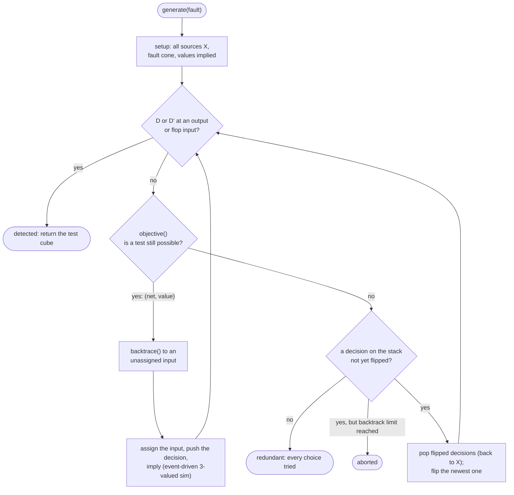
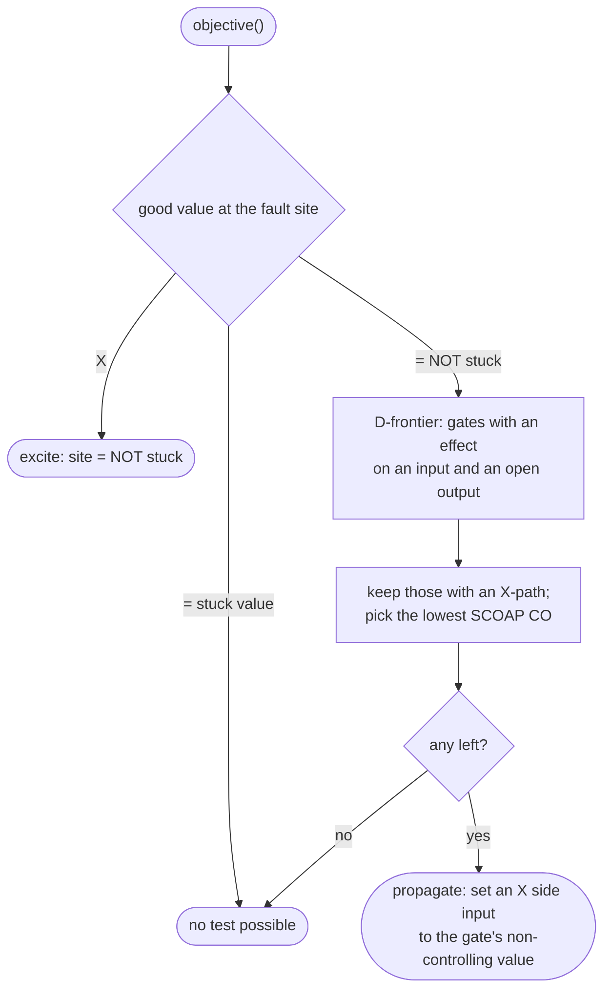
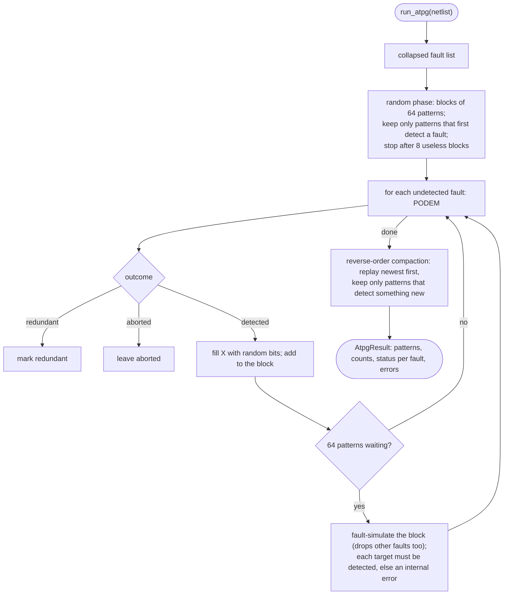

# Test generation (ATPG)

Files: `include/rith/atpg.hpp`, `src/atpg.cpp`

[Back to the index](../README.md) · [Architecture](../architecture.md)

## What it is for

Random patterns detect most faults cheaply, but some faults need one very specific
input combination. **ATPG** (automatic test pattern generation) works out such a
pattern for one target fault at a time, or proves that none exists. A fault with no
test is **redundant**: the logic around it can never show the difference.

The module has two parts:

1. `Podem`: generates a test for one fault with the PODEM algorithm.
2. `run_atpg`: the whole flow for a netlist: random patterns, PODEM for what is left,
   compaction.

Everything works in the [full-scan view](../README.md#words-used-on-these-pages):
inputs and flops are what the tester sets, outputs and flop D inputs are what it reads.

## Five values: good and faulty machine together

PODEM simulates two copies of the circuit at once: the **good** machine and the
**faulty** one (with the fault injected). Each net holds a pair of three-valued
values (0, 1 or X for "not decided yet"):

| Pair (good, faulty) | Name | Meaning |
|---|---|---|
| (0, 0) / (1, 1) | 0 / 1 | same in both machines |
| (1, 0) | D | the fault effect: good 1, faulty 0 |
| (0, 1) | D' | the fault effect the other way round |
| anything with an X | X | not settled yet |

A fault is **detected** when some output or flop input holds D or D'.

## The PODEM loop (`Podem::Impl::run`)

PODEM (Goel, 1981) only ever makes decisions on **inputs and scan flops**. Every other
value follows by simulation. That keeps the search small: at most two choices per input.

A test is no longer possible (and PODEM backtracks) when:

- the fault site already holds the stuck value, so the fault can never be excited; or
- the fault is excited but the **D-frontier** is empty: no gate with D or D' on an
  input still has an open output; or
- no D-frontier gate has an **X-path**: a path of still-open nets to an output.

All three tests are exact under three-valued simulation, so when every choice has been
tried the fault really is redundant.

### Objective (`objective`)

Non-controlling values: 1 for AND/NAND, 0 for OR/NOR. For XOR any value passes the
effect, so the easier one by SCOAP is asked for. For a MUX with the effect on a data
input, the select is set to pick that input.

### Backtrace (`backtrace`)

Backtrace walks from the objective back to an input, choosing one unassigned fan-in
at each gate and flipping the wanted value through inverting gates. The choice follows
Goel's rule with [SCOAP](testability.md) controllability:

| Situation | Example | Choose |
|---|---|---|
| every input must get the value | AND output 1 | the **hardest** input (largest CC) first, to fail fast |
| any one input will do | AND output 0 | the **easiest** input (smallest CC) |
| XOR / XNOR | | the easiest input; wanted value adjusted by the parity of the set inputs |
| MUX | | the select if a data input already has the value, else a data input |

## The whole flow (`run_atpg`)

**Coverage** is detected faults over all faults. **Efficiency** is detected plus
proved-redundant faults over all faults: it says how much of the work ATPG finished.
Both are reported on uncollapsed faults.

## Choices the paper leaves open

These are documented in the header and kept stable so traces are reproducible:

- D-frontier gate: the one with an X-path and the lowest SCOAP CO, ties by gate id.
- XOR backtrace: the easiest unassigned input, value from the parity of set inputs.
- Each decision is flipped once at most (a complete search); `backtrack_limit` caps
  the number of flips, after which the fault is aborted, not called redundant.

## Checking it

`rith atpg x.bench --trace "n12 SA0"` prints every step (objective, backtrace,
backtrack) for one fault, for reading next to the paper.

The [tests](tests.md) compare PODEM with brute force: on every fault of c17, s27 and
150 random circuits with every gate type, PODEM with no backtrack limit must say
detected exactly when some input assignment detects the fault, and its cube must
detect it whatever the X bits are set to.

## Known limits

- Plain PODEM cannot prove some redundancies in reasonable time (c432, c499, c1355).
  Learning (SOCRATES) and a SAT fallback are the planned next steps.
- PODEM runs on one thread; only fault simulation uses several.
- Patterns are written as plain text; STIL patterns are planned.
