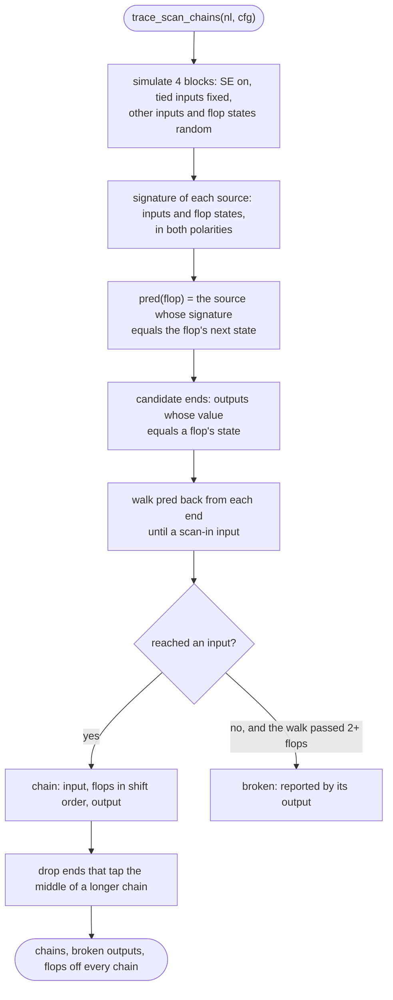

# Tracing existing scan chains

Files: `include/rith/chains.hpp`, `src/chains.cpp`. Command: `rith chains`.

## What it is for

A netlist from Design Compiler, Genus or another DFT tool already has scan chains.
`trace_scan_chains()` finds them, so rith can confirm it reads the netlist the way the
tool meant it: how many chains, which ports they run between, and which flops are on
each one, in shift order. It needs no pin names and no protocol file.

```sh
rith --lib saed32.lib chains dc_scan.v              # scan enable found by name (SE, test_se, ...)
rith --lib saed32.lib chains dc_scan.v --cells      # list every cell in shift order
rith --lib saed32.lib chains dc_scan.v --se scan_en --se-active 1 --tie test_mode=1
```

## How it works

The netlist's full-scan view (flops cut into sources) is simulated in **shift mode**:
scan enable on, inputs named with `--tie` held constant, every other input and every
flop state random. Then each flop's next state is matched against every source:

- if a flop's next state equals one scan-in input or one other flop (or its inverse),
  over all 256 patterns, that is its predecessor in shift;
- otherwise it has none (it does not shift, or it mixes several sources).



Matching values instead of following pins means the trace sees through anything that
copies data in shift mode: buffers, inverters (tracked as inversions), the scan mux
inside a scan cell, **lockup latches** (modelled as transparent) and plain flops in
**shift-register segments**, which DC leaves as non-scan cells because the previous
flop already drives their D pin.

Limits: it is a simulation, so two sources that happen to copy the same value would be
ambiguous (with 256 random bits this does not happen in practice). With scan enable
held off, functional shift paths (a flop whose D is another flop's Q) look like chains
too; that is why `rith chains` tries the active-high polarity first and only falls back
to active-low when nothing shifts.

## Checked against TetraMAX

On 19 DC-inserted SAED32 netlists (ISCAS'89, ITC'99 and three OpenCores designs up to
17,055 scan cells, including shift-register segments and a lockup latch), the traced
chain lengths match TetraMAX's `run_drc` chain trace exactly.
