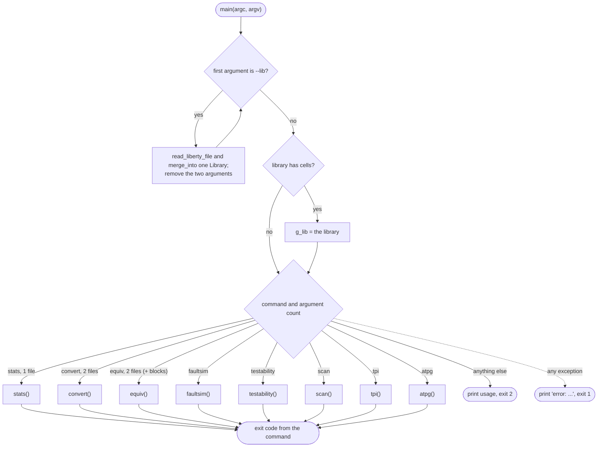
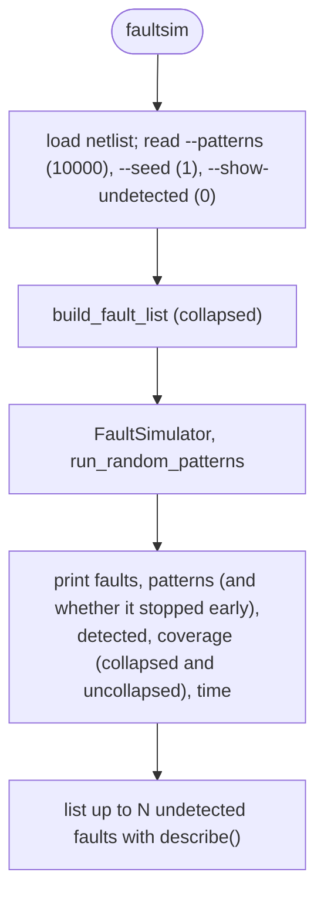
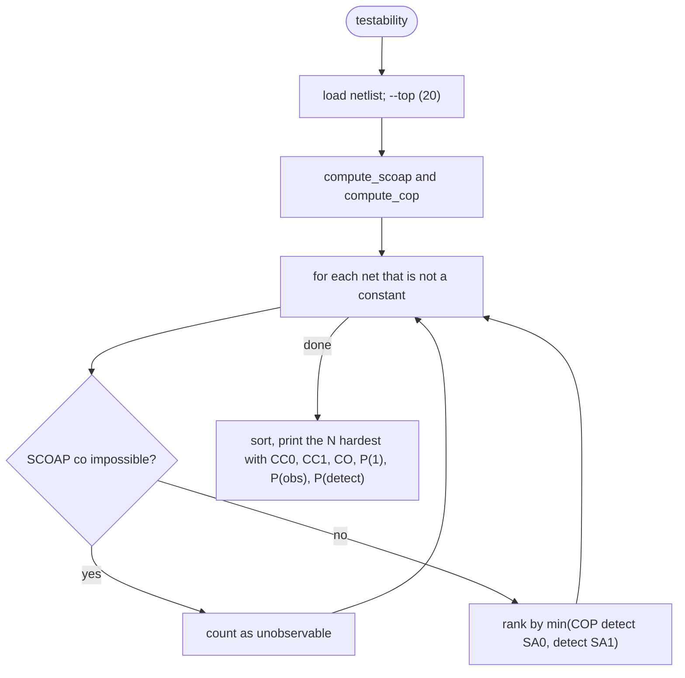
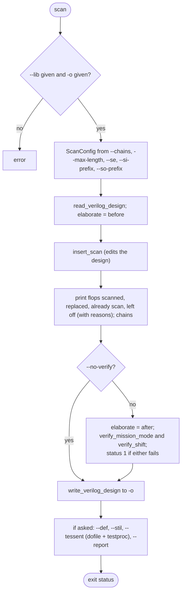
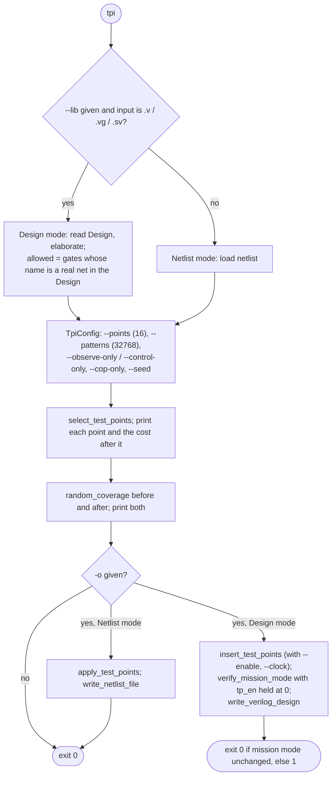
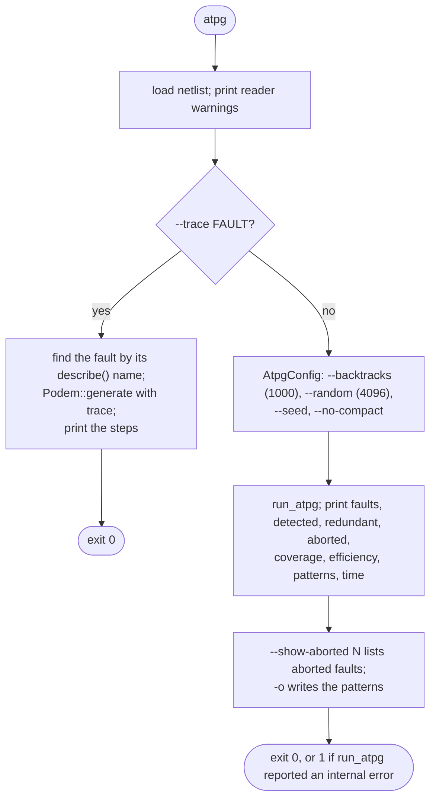

# The `rith` command

File: `tools/rith_main.cpp`

[Back to the index](../README.md) · [Architecture](../architecture.md)

## What it is for

`rith` is the program people run. It reads the command line, loads the files, calls
the library functions described on the other pages, and prints the results. It holds
no DFT logic of its own.

| Command | Does | Main library calls |
|---|---|---|
| `stats <netlist>` | size, depth, gate mix | `read_netlist_file` |
| `convert <in> <out>` | BENCH to Verilog or back | `read_netlist_file`, `write_netlist_file` |
| `equiv <a> <b> [blocks]` | random equivalence check | `compare_by_simulation` |
| `faultsim <netlist>` | random-pattern stuck-at coverage | `build_fault_list`, `FaultSimulator`, `run_random_patterns` |
| `testability <netlist>` | hardest nets by SCOAP/COP | `compute_scoap`, `compute_cop` |
| `scan <netlist.v> -o out.v` | scan insertion | `insert_scan`, `verify_mission_mode`, `verify_shift`, the writers |
| `tpi <netlist>` | test point selection and insertion | `select_test_points`, `random_coverage`, `insert_test_points` or `apply_test_points` |
| `atpg <netlist>` | stuck-at test generation | `run_atpg`, `write_patterns`, or `Podem::generate` with `--trace` |

## `main()`: dispatch

Options after the positional arguments are read with three small helpers:
`option()` (a number), `text_option()` (a string) and `flag()` (present or not).
`load()` reads a netlist and prints any reader warnings to stderr.

## `faultsim`

## `testability`

## `scan`

## `tpi`

## `atpg`

In Design mode points are only allowed on nets that exist in the Verilog, not on the
internal gates that elaboration made inside a cell, so they can be inserted with real
cells.
