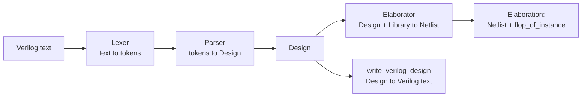
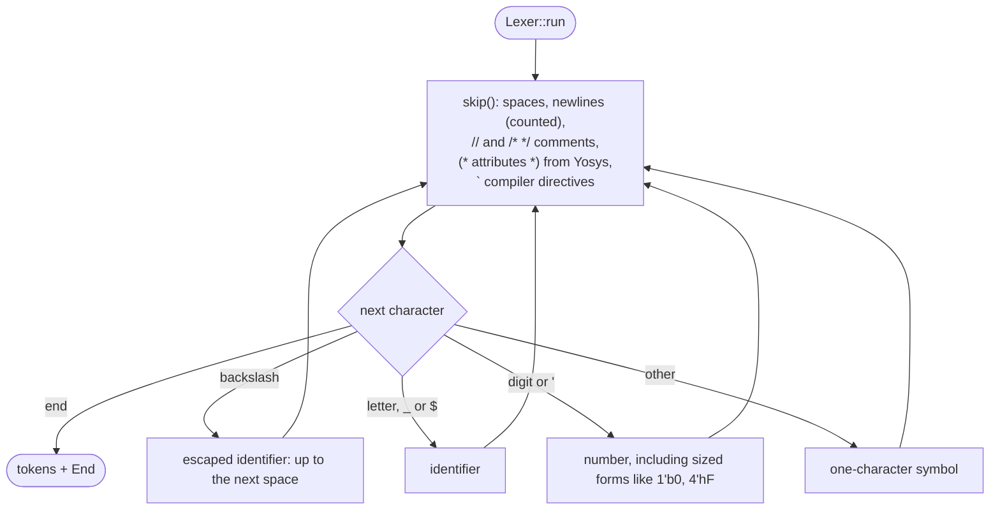
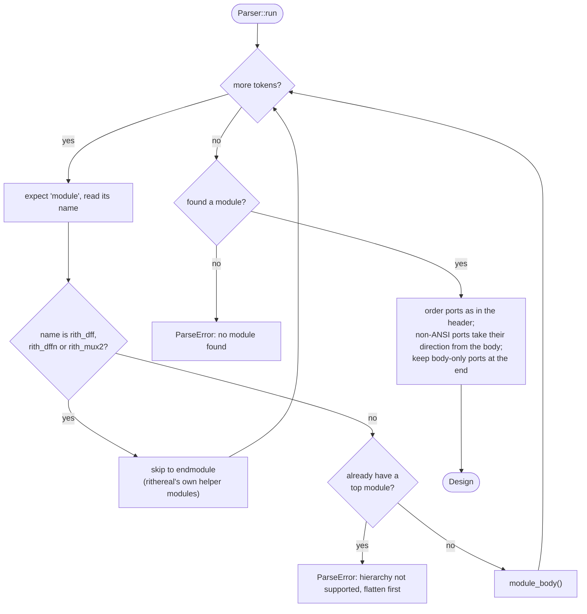
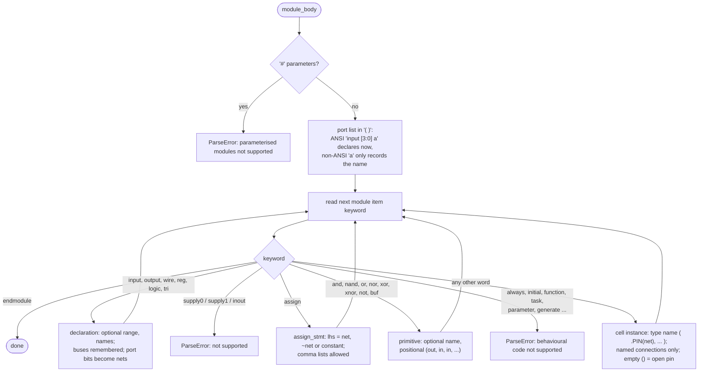
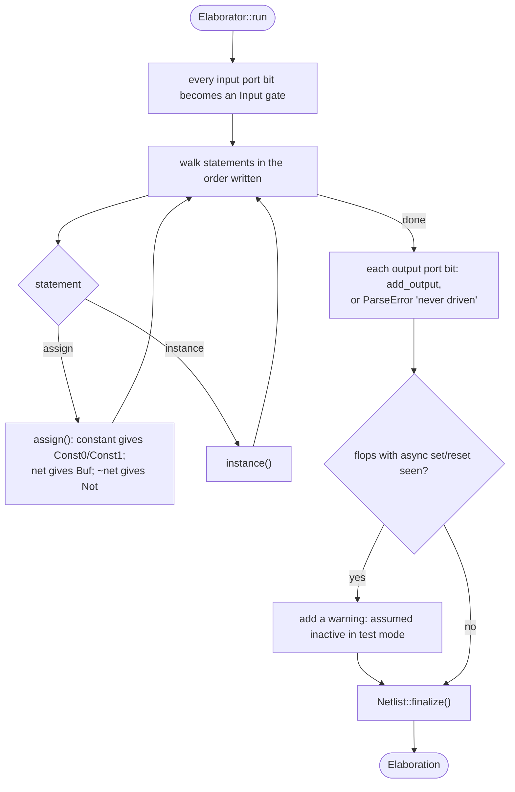
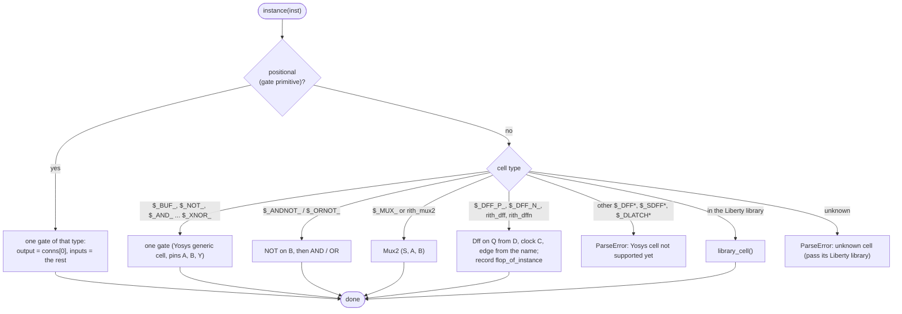
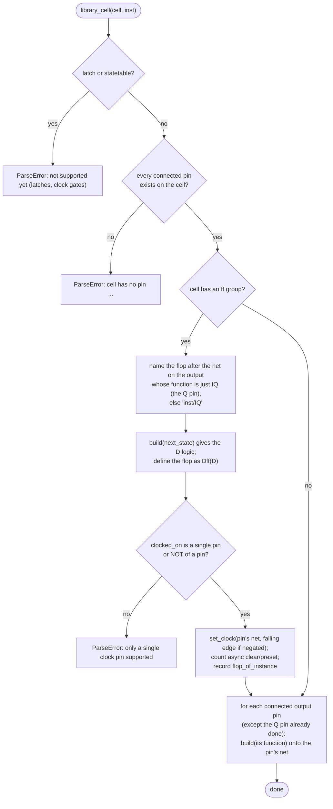
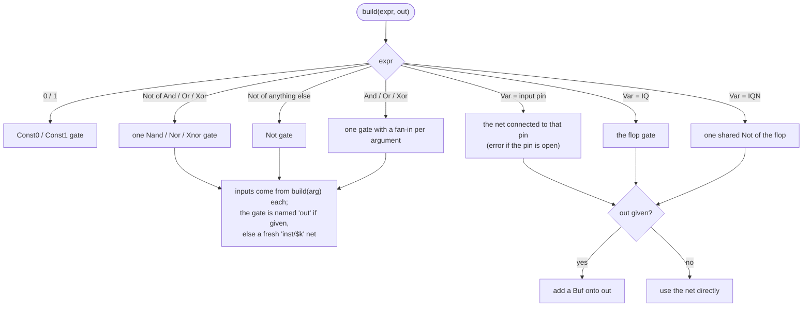
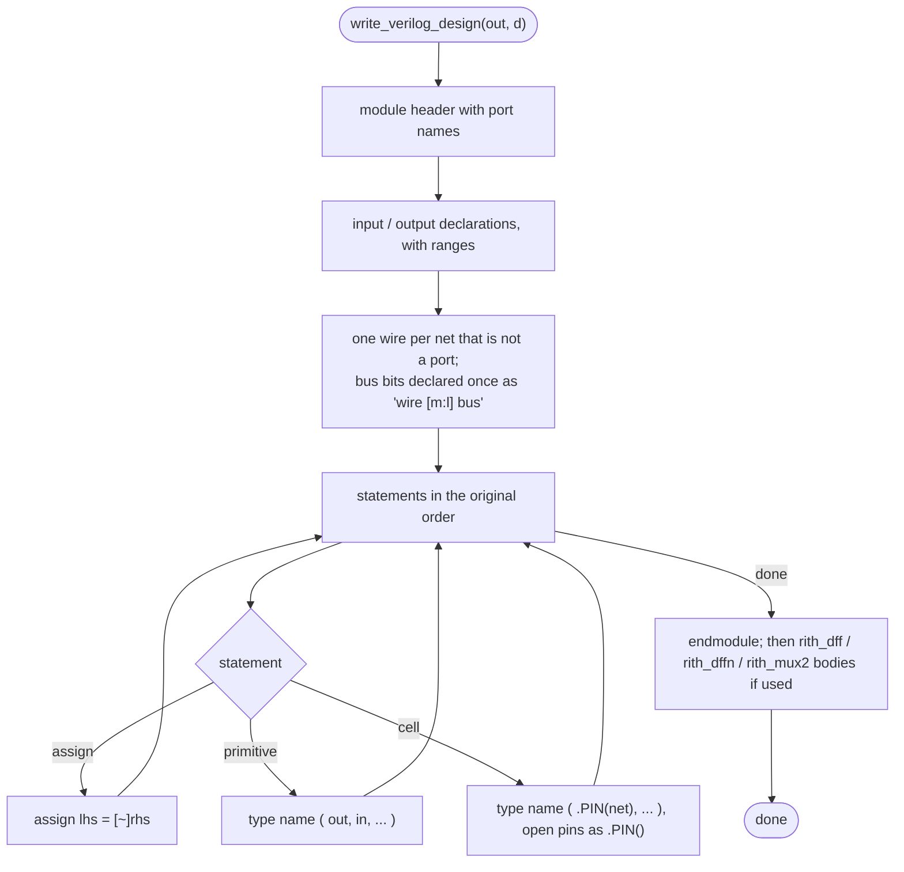

# Structural design view

Files: `include/rith/design.hpp`, `src/design.cpp`

[Back to the index](../README.md) · [Architecture](../architecture.md)

## What it is for

A `Design` keeps a flat Verilog netlist **as written**: library cell instances with
named pin connections, gate primitives, `assign` statements, ports and buses. Passes
that edit the circuit (scan insertion, test point insertion) work on it and write it
back with the original cell names, so the result can go straight back into Design
Compiler, Genus, Tessent or OpenROAD.

`design.cpp` has four parts:

## The data model

| Type | Holds |
|---|---|
| `NetId` | Number of a one-bit net. Special values: `kNoNet` (pin left open), `kConst0Net` (`1'b0`), `kConst1Net` (`1'b1`). A bus bit is its own net, named like `data[3]`. |
| `PortDecl` | Port name, direction, optional bit range. |
| `Instance` | Cell or primitive type, instance name, `positional` (primitives: first connection is the output), list of `PinConn {pin, net}`, source line. |
| `Assign` | `lhs = rhs` or `lhs = ~rhs`; `rhs` may be a constant. |
| `Design` | Name, ports, buses, instances, assigns, the order statements were written in, and the net name table. |

Helpers used by the editing passes: `net()` (find or create), `find_net()`,
`fresh_net(prefix)` and `fresh_instance_name(prefix)` (a name not used yet),
`add_port()`, `add_instance()`, `add_assign()`, `Instance::connect()`.

## Lexer

## Parser

The parser makes one pass over the tokens. It has no knowledge of cells; the
elaborator checks those later.

A net reference (`net_ref`) is a constant (`1'b0`, `0`, `1'h1`), a bus bit
(`data[3]`), a one-bit bus used by its name, or a plain net. Concatenations
(`{a, b}`), part-selects (`a[3:0]`), multi-bit constants and `x`/`z` values give a
clear error.

## Elaborator: Design to gates

`elaborate()` builds a `Netlist` of primitive gates from the `Design`. It also fills
`flop_of_instance`, which says for each instance which `Dff` gate it became, so the
scan and TPI passes can map results back to instances.

Constant nets become two shared gates, `rith_const0` and `rith_const1`, created on
first use.

### `instance()`: what kind of cell is it?

### `library_cell()`: expand a Liberty cell into gates

`build(expr, out)` turns a `LibExpr` tree into gates, recursively:

## Writer (`write_verilog_design`)

Bus bits keep their bus syntax (`data[3]`), other names are escaped only when they
need it, and constants print as `1'b0` / `1'b1`. The design round-trips: reading
and writing again gives the same netlist.
