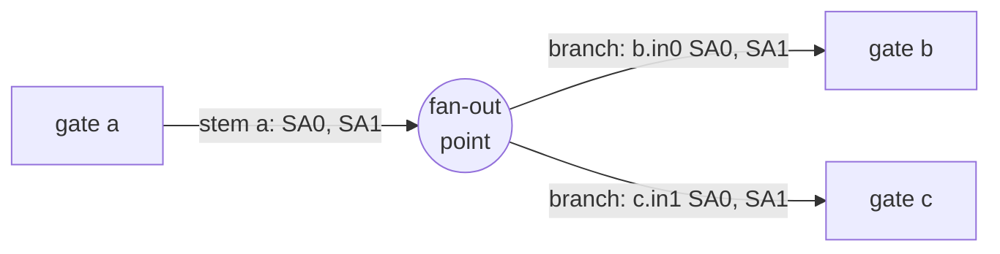
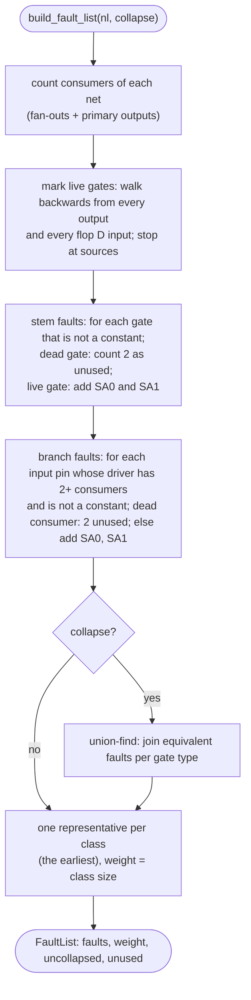
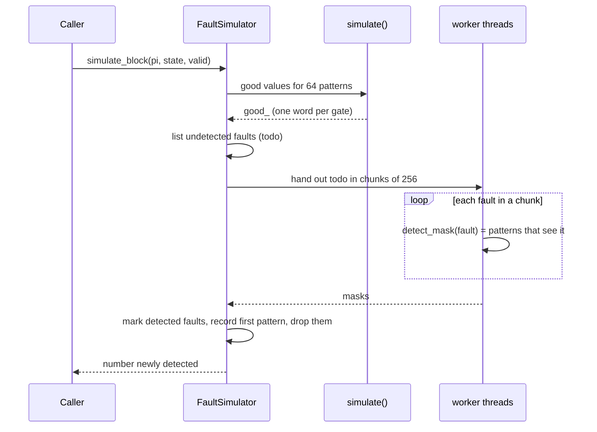
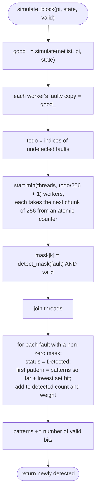
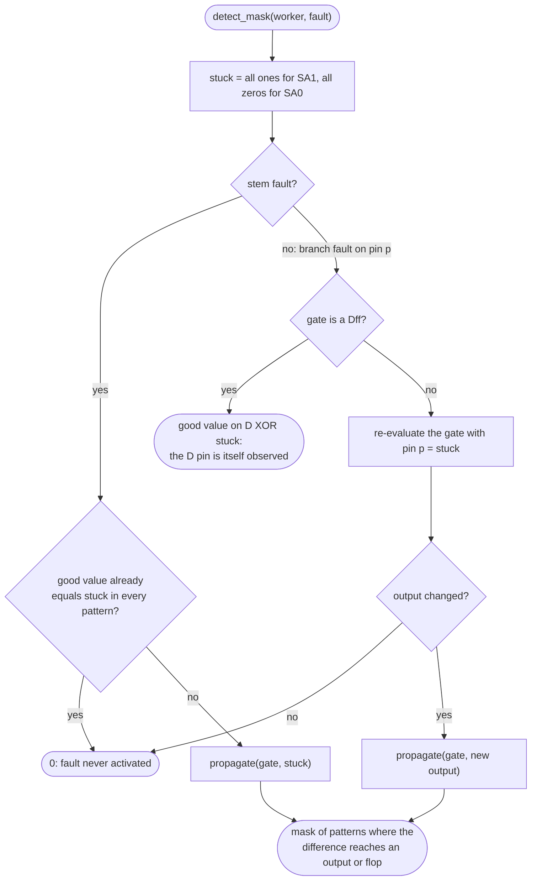
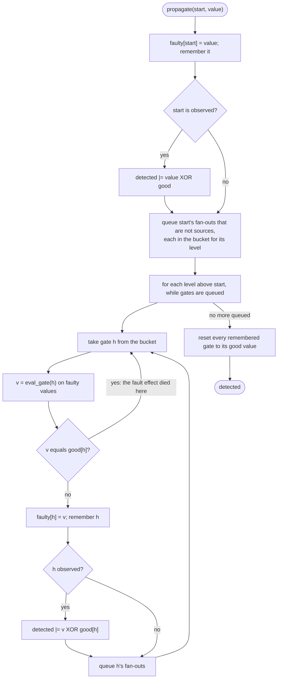
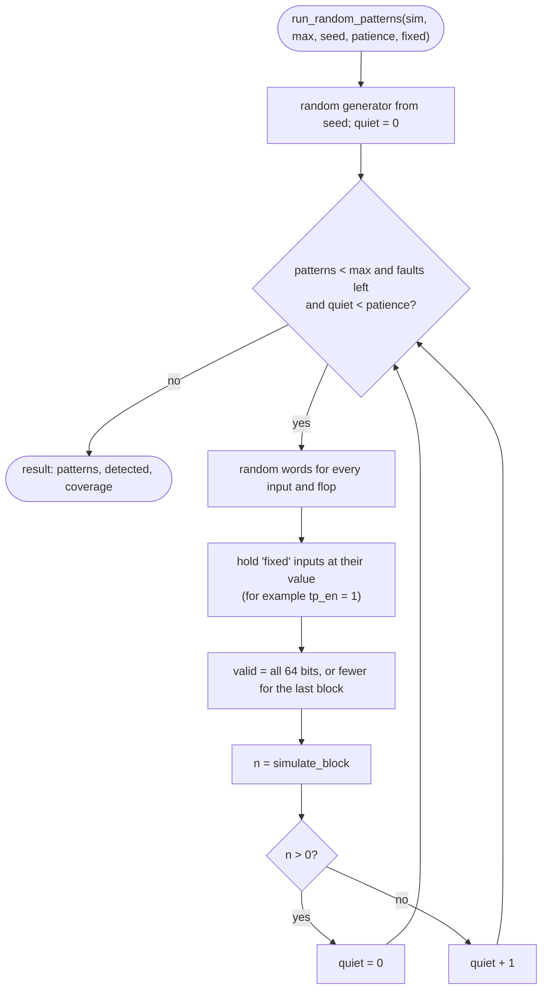

# Faults and fault simulation

Files: `include/rith/fault.hpp`, `src/fault.cpp`

[Back to the index](../README.md) · [Architecture](../architecture.md)

## What it is for

This module answers: "if the chip had a defect here, would these test patterns
notice?" It has three parts:

1. `build_fault_list()` lists every single stuck-at fault and merges the ones that
   can never be told apart (collapsing).
2. `FaultSimulator` runs blocks of 64 patterns and marks which faults each block
   detects, using several threads.
3. `run_random_patterns()` feeds the simulator random patterns until coverage stops
   improving.

## Where faults sit

A `Fault` is `{gate, pin, stuck_at_one}`.

- `pin == kOutputPin` (-1): a **stem** fault on the gate's output net.
- `pin >= 0`: a **branch** fault on one input pin of the gate. Branch faults are
  only made where the driving net goes to two or more places (counting primary
  outputs). With a single consumer, the branch is the same wire as the stem.

## `build_fault_list()`

**Live** means some output or flop can see the gate. Faults in dead logic (and on
nets like clock and reset ports, which feed nothing in the scan view) can never be
detected, so they are counted separately as `unused` instead of lowering coverage.

### Which faults are equivalent

For each gate, an input fault and an output fault that always give the same wrong
output are joined. "Input fault" means the branch fault if there is one, else the
driver's stem fault.

| Gate | Joined |
|---|---|
| AND | any input SA0 = output SA0 |
| NAND | any input SA0 = output SA1 |
| OR | any input SA1 = output SA1 |
| NOR | any input SA1 = output SA0 |
| BUF | input SA0 = output SA0, input SA1 = output SA1 |
| NOT | input SA0 = output SA1, input SA1 = output SA0 |
| XOR, XNOR, MUX, DFF | nothing (no structural equivalence) |

The union-find always keeps the smaller index as the class leader, so the result is
the same on every run.

## `FaultSimulator`

The method is **parallel-pattern single-fault propagation (PPSFP)**: for one block of
64 patterns, simulate the good circuit once, then for each fault simulate only the
part of the circuit the fault changes.

### `simulate_block()`

Detected faults are not simulated again (fault dropping), so later blocks get faster.

### `detect_mask()`: does this block see this fault?

### `propagate()`: event-driven, level by level

"Observed" means a primary output or a flop's D input. Flops are not evaluated as
gates; their D pin is an observation point. Each thread has its own `Worker`
scratch space (faulty values, queue flags, level buckets), so threads never share
writable memory.

## `run_random_patterns()`

`patience = 0` means "never stop early". Coverage is reported two ways: over the
collapsed list (`coverage`) and weighted by class size (`coverage_uncollapsed`).

`describe()` prints a fault for people, for example `n12 SA0` for a stem or
`n12 -> U5.in1 SA1` for a branch.
