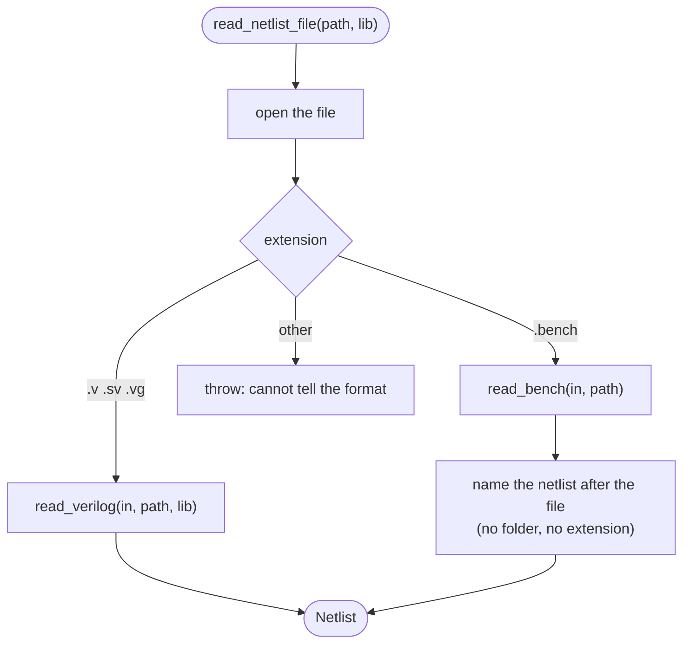
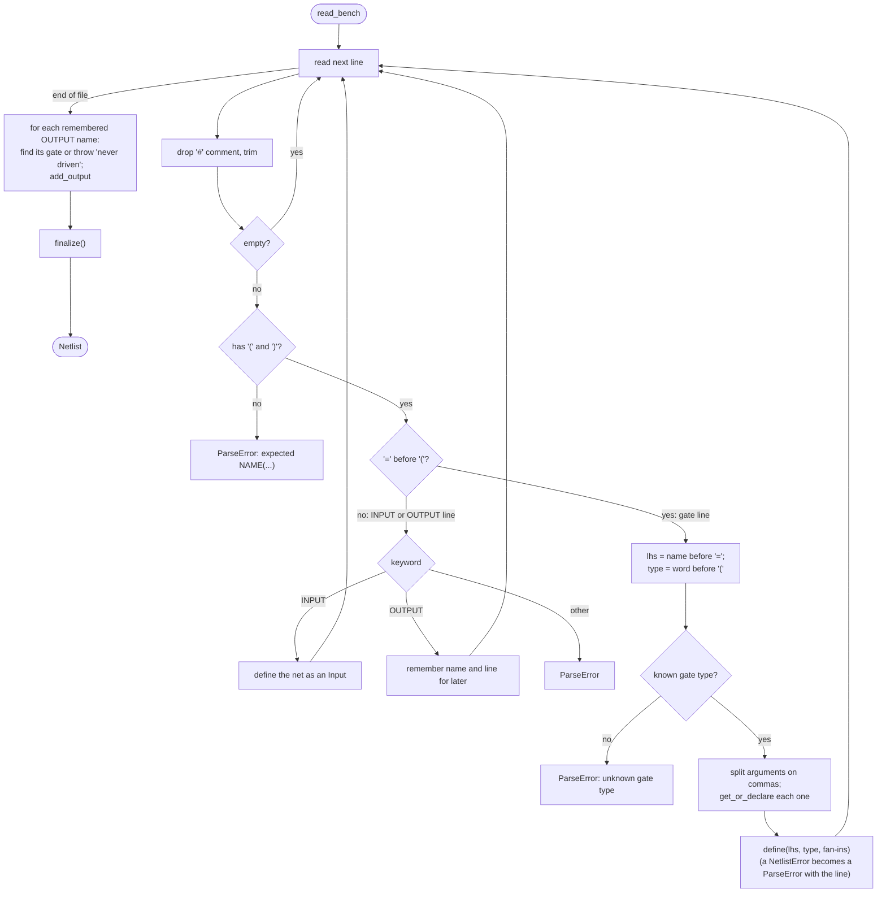
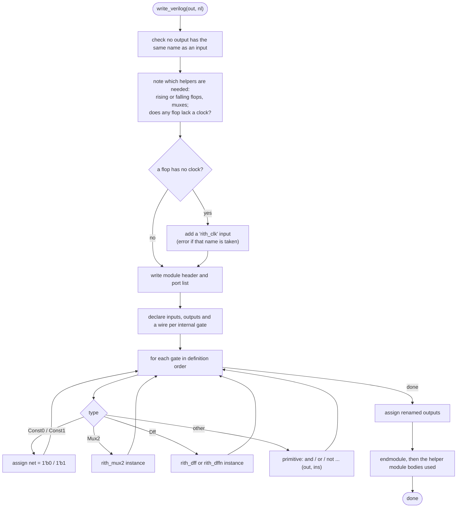
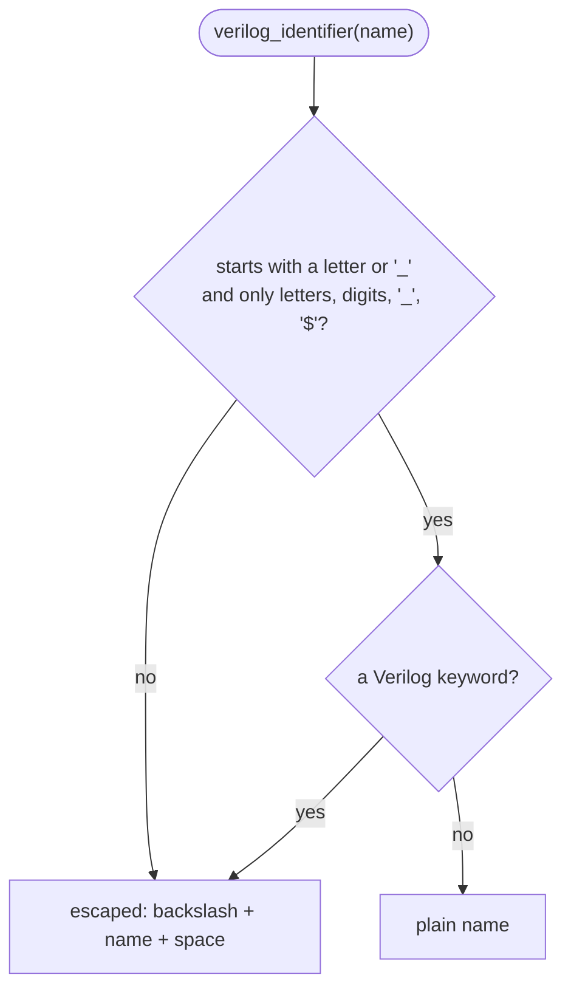

# Netlist readers and writers

Files: `include/rith/io.hpp`, `src/bench.cpp`, `src/verilog.cpp`, `src/file_io.cpp`

[Back to the index](../README.md) · [Architecture](../architecture.md)

## What it is for

Getting circuits into and out of a `Netlist`:

| Function | File | Direction |
|---|---|---|
| `read_bench` / `write_bench` | `bench.cpp` | ISCAS BENCH format |
| `read_verilog` | `verilog.cpp` | Verilog to `Netlist` (via the [Design view](design.md)) |
| `write_verilog` | `verilog.cpp` | `Netlist` to generic gate-level Verilog |
| `verilog_identifier` | `verilog.cpp` | Escapes names that are not plain Verilog identifiers |
| `read_netlist_file` / `write_netlist_file` | `file_io.cpp` | Picks the format by file extension |

Errors in input files are thrown as `ParseError`, whose message is
`file:line: what went wrong`.

## Picking a format (`file_io.cpp`)



`write_netlist_file` does the same choice and calls `write_bench` or
`write_verilog`.

## BENCH reader (`read_bench`)

A BENCH file looks like:

```text
INPUT(G1)
OUTPUT(G22)
G10 = NAND(G1, G3)
G5  = DFF(G10)
```



Outputs are resolved at the end because a BENCH file may list `OUTPUT(x)` before
the line that drives `x`.

`write_bench` writes a short header, then `INPUT(...)` and `OUTPUT(...)` lines, then
one `name = TYPE(fanins)` line per gate in definition order. It refuses outputs
whose port name differs from the driving net, since BENCH cannot express that.

## Verilog reader (`read_verilog`)

`read_verilog` is one line: it parses the file into a `Design` and elaborates it
into a `Netlist`. All the work is in [design.md](design.md).


## Generic Verilog writer (`write_verilog`)

This writes a `Netlist` (not a `Design`) as Verilog using only gate primitives and
three small helper modules that rithereal defines itself: `rith_dff`, `rith_dffn`
(falling edge) and `rith_mux2`. It is used by `rith convert`.



## `verilog_identifier`


