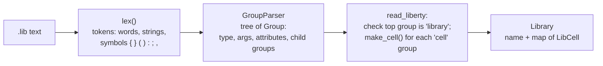
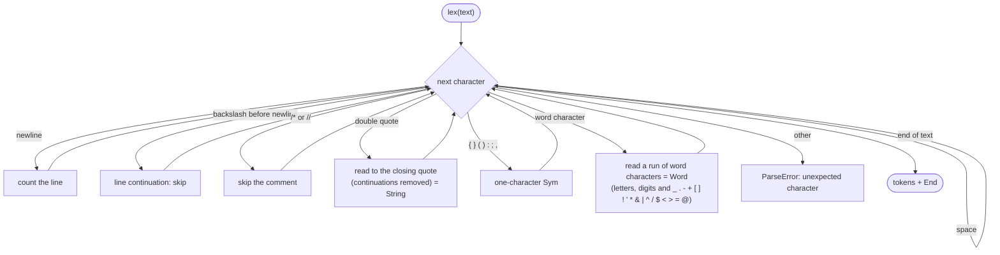
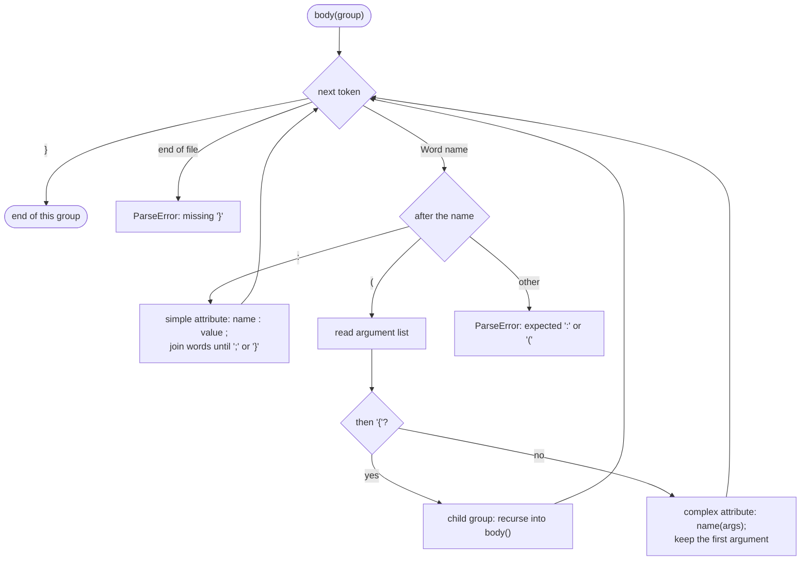
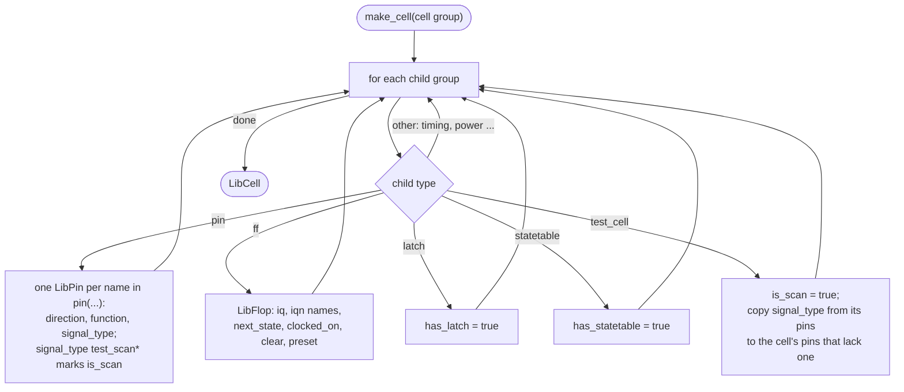
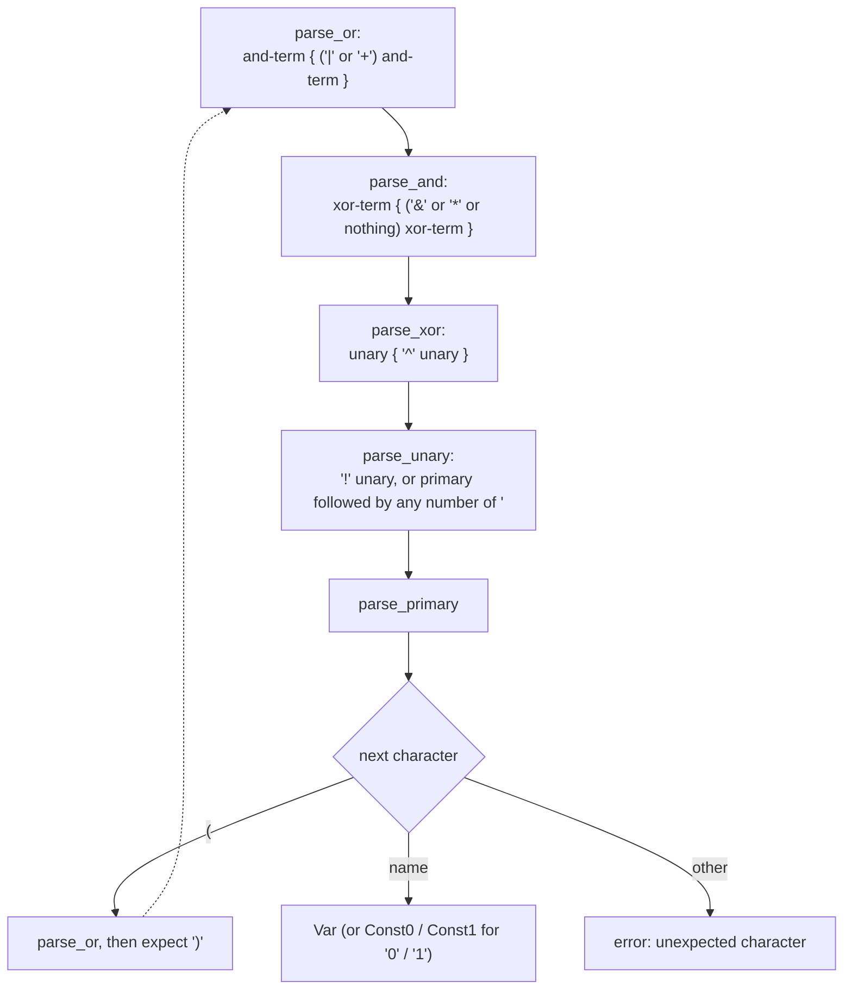
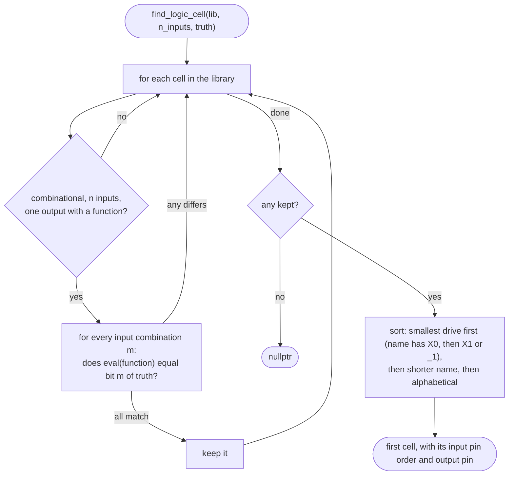

# Liberty library reader

Files: `include/rith/liberty.hpp`, `src/liberty.cpp`, `src/libfunc.hpp`

[Back to the index](../README.md) · [Architecture](../architecture.md)

## What it is for

A Liberty file (`.lib`) is the chip factory's description of its cells. rithereal
reads only the **logic** part of it and skips timing and power:

- each pin's name, direction, Boolean `function` and `signal_type` (scan pins);
- the `ff` group of flip-flops (`next_state`, `clocked_on`, `clear`, `preset`);
- whether a cell has a `latch` or `statetable` group (not supported yet);
- whether a cell is a scan cell (`test_cell` group or `test_scan_*` signal types).

This lets the [Design elaborator](design.md) turn any library cell into primitive
gates, and lets [scan insertion](scan.md) and [TPI](tpi.md) find the cells they need
by what they do rather than by name.

## Reading a library

Reading happens in three steps: split the text into tokens, build a tree of groups,
then pick the cells out of the tree.

### `lex()`

Function operators such as `!`, `&`, `|` are word characters, so an unquoted
function stays in one piece.

### `GroupParser`

Liberty has three kinds of statement, and the parser tells them apart by what
follows the name:

### `make_cell()`

`merge_into()` joins several libraries (from repeated `--lib` options); a later
file wins when two define the same cell name.

## Boolean functions (`parse_liberty_function`)

Cell functions such as `"!(A1 & A2) | B"` or `"(D&!SE) | (SI&SE)"` are parsed into
a small tree, `LibExpr`, by a recursive-descent parser. Operator strength, from
strongest to weakest:

| Strength | Operators | Meaning |
|---|---|---|
| 1 | `!x`, `x'` | NOT |
| 2 | `^` | XOR |
| 3 | `&`, `*`, or just a space (`A B`) | AND |
| 4 | `\|`, `+` | OR |

`binary()` flattens chains, so `A & B & C` becomes one AND node with three
arguments instead of a nest of two-input nodes.

## `libfunc.hpp`: evaluating functions by truth table

This private header is shared by `scan.cpp` and `tpi.cpp`. It answers questions
like "do these two cells do the same thing?" by trying every combination of inputs.

| Function | What it does |
|---|---|
| `eval(expr, ff, env)` | Value of a function for one set of input values. The flop's state variable (for example `IQ`) is read from a shared name `@IQ`, so two different cells' states can be compared. `IQN` reads as NOT `@IQ`. |
| `for_all(vars, base, f)` | Calls `f` for every 0/1 assignment of `vars` (at most 16 variables, so at most 65,536 cases), stopping at the first `false`. |
| `input_pins(cell)` | Names of the cell's input pins, in order. |
| `parse_opt(text)` | Parses a function, or returns nothing if it is empty or invalid. |
| `find_logic_cell(lib, n, truth)` | Finds a one-output combinational cell with `n` inputs whose truth table equals `truth`, e.g. an AND2 is `0b1000`. |

