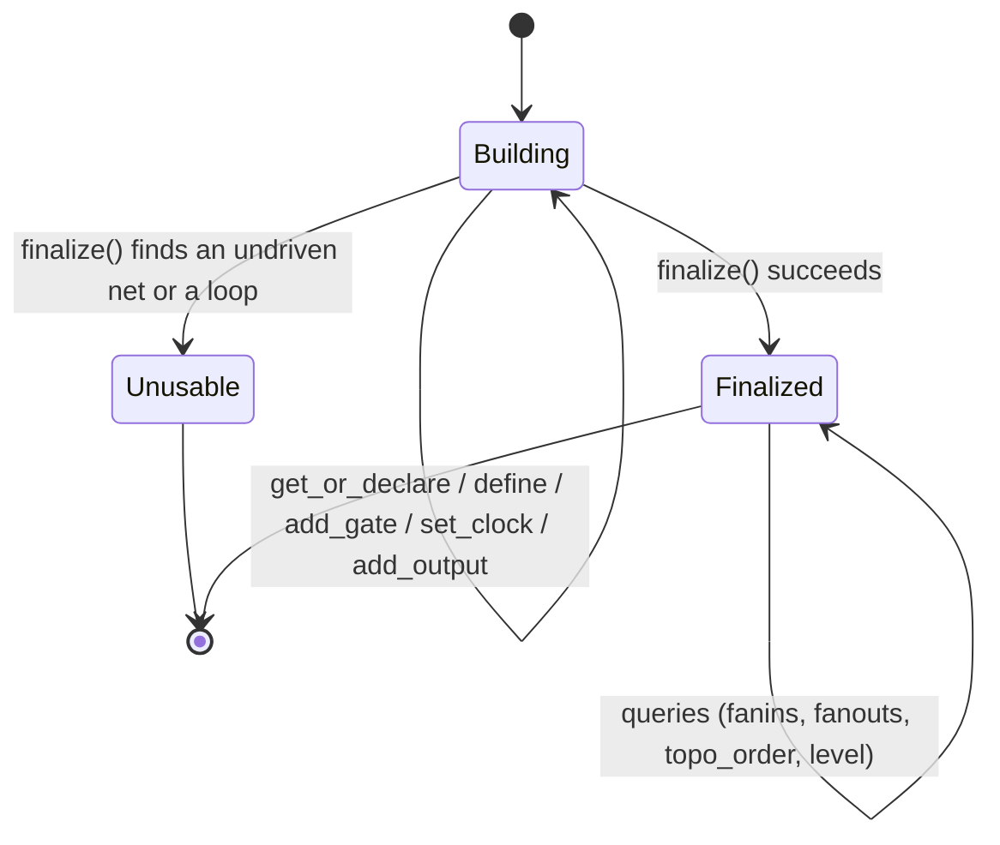
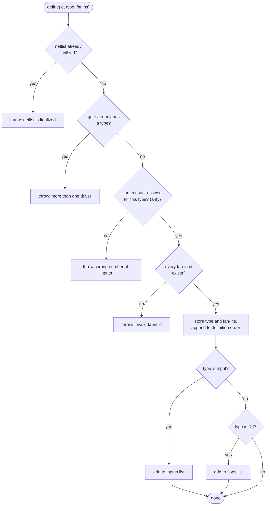
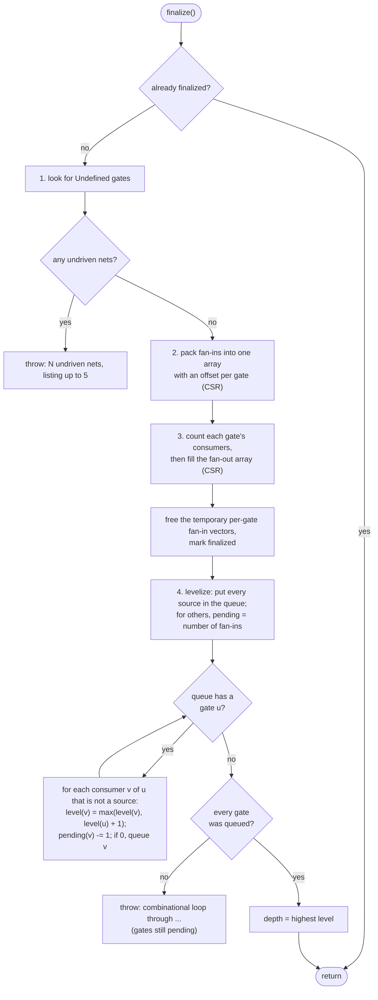
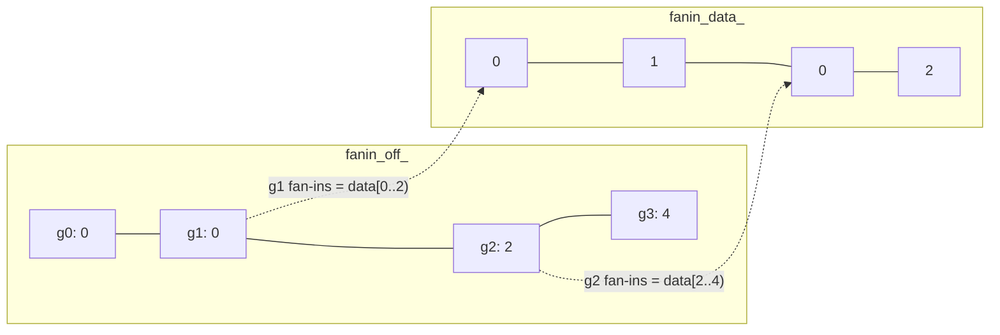
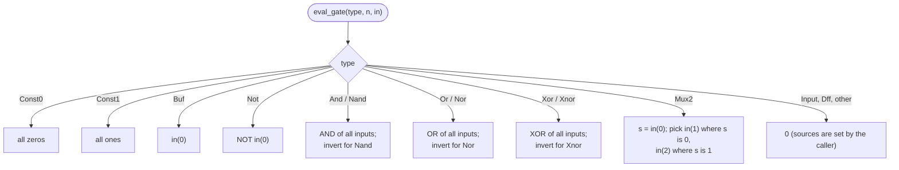

# Netlist core

Files: `include/rith/netlist.hpp`, `src/netlist.cpp`, `include/rith/eval.hpp`

[Back to the index](../README.md) · [Architecture](../architecture.md)

## What it is for

`Netlist` is the data structure every analysis in rithereal works on. It is a flat
graph of primitive gates. Each gate drives exactly one net, and the net carries the
gate's name, so "gate" and "net" mean the same thing here and share one number, the
`GateId`.

Gate types (`GateType`): `Input`, `Const0`, `Const1`, `Buf`, `Not`, `And`, `Nand`,
`Or`, `Nor`, `Xor`, `Xnor`, `Mux2` (fan-ins are select, in0, in1) and `Dff` (one
fan-in, D; the clock is stored separately in `Gate::clock`). `Undefined` marks a net
that has been mentioned but not yet driven.

**Sources** (`is_source`) are inputs, constants and flops. In the full-scan view
they are where values start, so levelization begins from them.

## Life of a Netlist

A `Netlist` is built in two phases: first you add gates, then `finalize()` freezes
it and computes everything the analyses need.

Readers can mention a net before the gate that drives it appears in the file
(BENCH and Verilog both allow this). `get_or_declare()` handles that by creating an
`Undefined` placeholder that `define()` fills in later.

## `define()`: giving a gate its type

Allowed fan-in counts (`arity()`): inputs and constants 0; `Buf`, `Not`, `Dff` 1;
`Mux2` 3; AND/OR/XOR families 1 or more.

## `finalize()`: freezing the graph

Step 4 is Kahn's topological sort. Flops count as sources, so the wire from a
gate into a flop's D pin is "cut": loops through flops are fine, loops made only of
gates are an error.

**CSR** (compressed sparse row) means all fan-in lists sit back to back in one big
array, and `fanin_off_[g]` .. `fanin_off_[g+1]` marks gate `g`'s slice. It uses less
memory and is faster to walk than one small vector per gate.

## Other functions in `netlist.cpp`

| Function | What it does |
|---|---|
| `to_string(GateType)` | Name of a type, e.g. `NAND`. |
| `gate_type_from_string()` | Reverse lookup, case-insensitive; accepts `BUFF`, `INV`, `MUX2`. |
| `find(net)` | Gate id by name, or `kNoGate`. |
| `add_gate()` | `get_or_declare` + `define` for a brand new name. |
| `set_clock()` | Records a flop's clock net and edge. |
| `add_output()` | Adds a primary output port pointing at a driver gate; rejects duplicates. |
| `fanins()` / `fanouts()` | Slices of the CSR arrays (fan-ins also work before finalize). |
| `count(type)` | How many gates of a type. |

## `eval.hpp`: one gate, 64 patterns

`eval_gate(type, n, in)` computes a gate's output for 64 patterns at once. A `Word`
is a 64-bit integer and each bit is one pattern, so an AND of 64 patterns is one `&`
instruction. `in(i)` is a small function that returns the word on input pin `i`;
the logic simulator passes real values, the fault simulator passes faulty ones.

