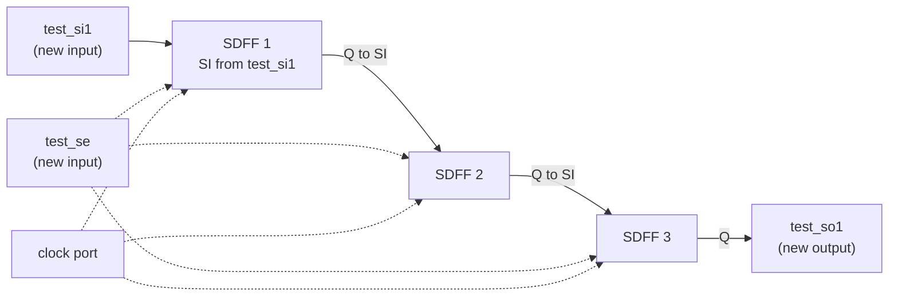
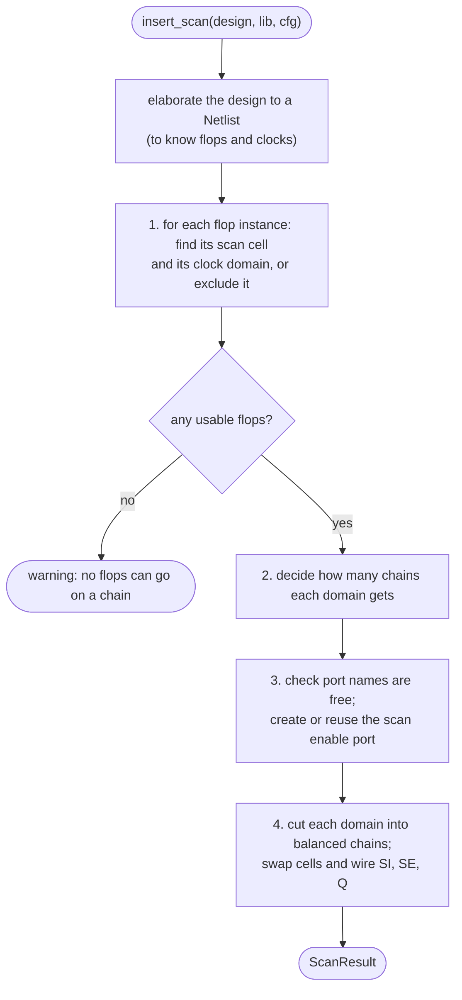
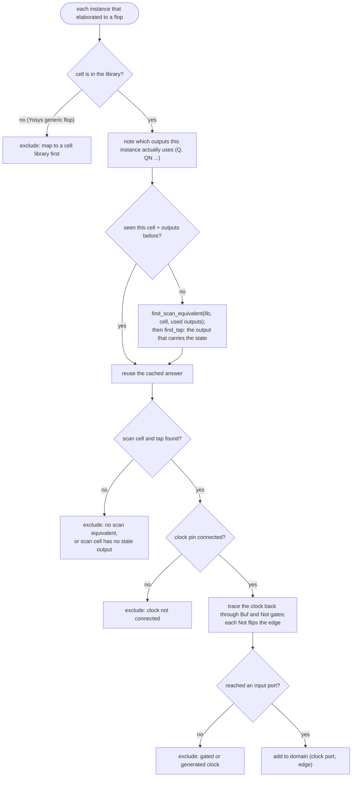
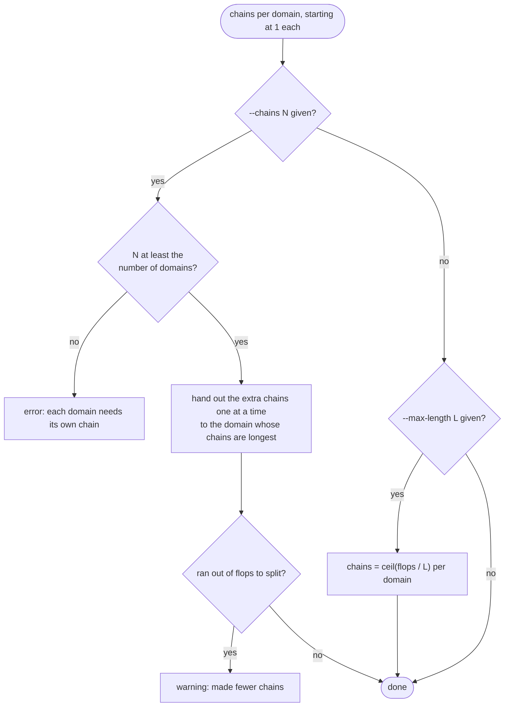
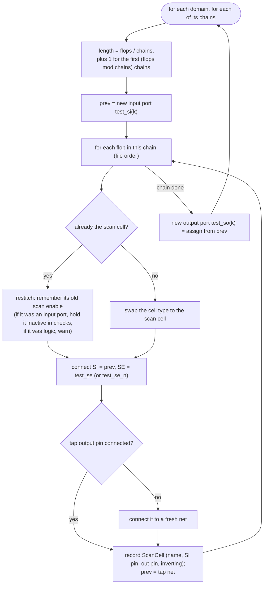
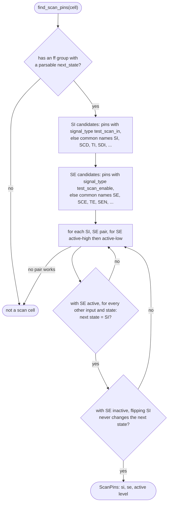
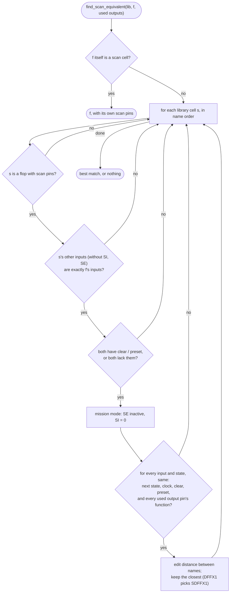
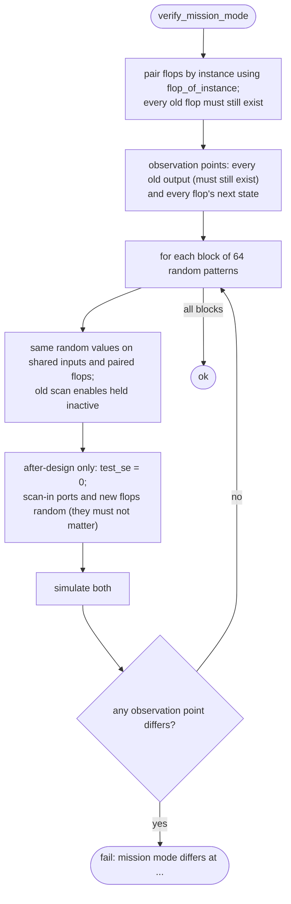
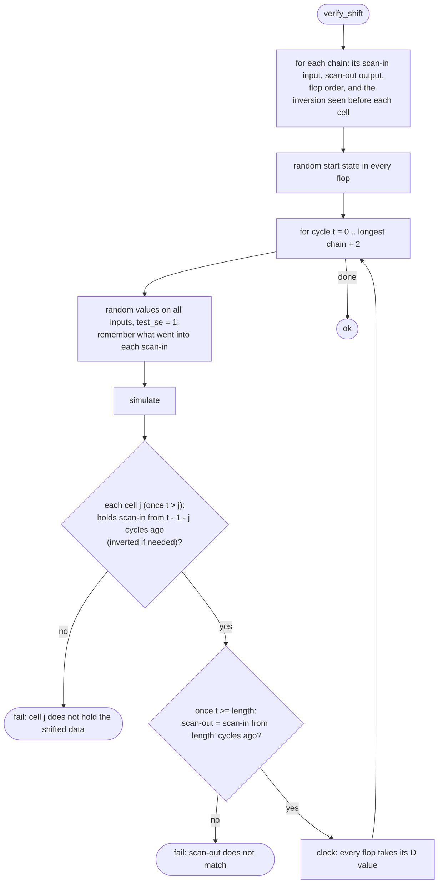
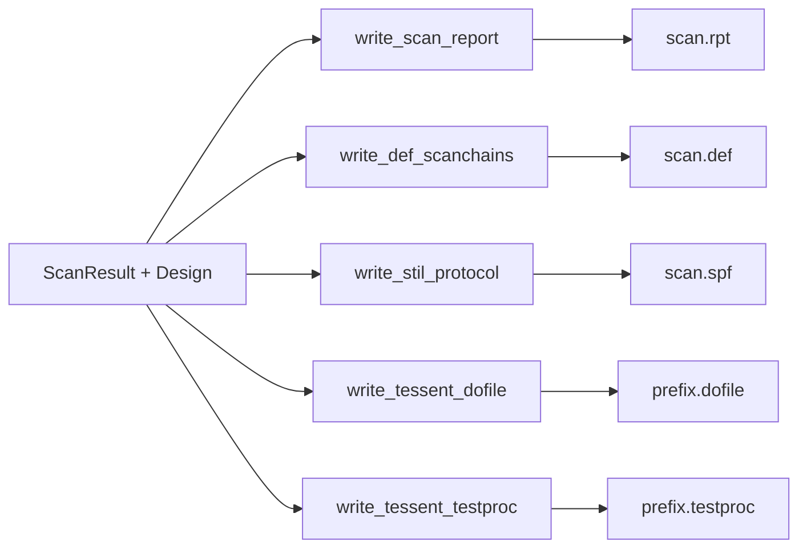

# Scan insertion

Files: `include/rith/scan.hpp`, `src/scan.cpp`, `src/scan_out.cpp`

[Back to the index](../README.md) · [Architecture](../architecture.md)

## What it is for

Scan insertion makes every flop loadable and readable by the tester. Each normal
flop is swapped for a **mux-D scan flop**: the same flop with a small multiplexer in
front of D. When scan enable (`test_se`) is 0 the flop works as before (mission
mode). When it is 1 the flop takes its value from the scan input (SI) instead, and
the flops, linked Q to SI, form a shift register (a **scan chain**).

`insert_scan()` edits a [`Design`](design.md) in place and returns a `ScanResult`
listing the chains, which flops were left off and why, and which cells were swapped.
Two checks then confirm the result by simulation, and `scan_out.cpp` writes files
for other tools.

## The whole pass

### Step 1: is this flop usable, and which domain is it in?

Grouping by clock **and** edge means each chain is clocked by one clock on one edge,
so chains never need lockup latches.

### Step 2: how many chains per domain

### Step 3: ports

- `test_si<k>` and `test_so<k>` must not exist yet (error naming the option to
  change: `--si-prefix`, `--so-prefix`).
- If `test_se` already exists as a one-bit input it is reused (with a warning);
  otherwise it is added.
- If a scan cell needs an **active-low** scan enable, one inverter cell from the
  library makes `test_se_n` on first use (`find_inverter` prefers cells named INV).

### Step 4: stitch

If a cell has no Q and the chain leaves by QN, the cell is marked `inverting`.
`ScanChain::inverted()` tells whether the scan-out sees the scan-in data inverted
overall.

## Finding scan cells by function

### `find_scan_pins(cell)`: is this a mux-scan flop, and which pins are SI and SE?

The names only suggest candidates; the truth-table test decides. That is how
active-low scan enables and unusual pin names work.

### `find_scan_equivalent(lib, flop)`: which scan cell can replace this flop?

`find_tap(cell, used)` picks the output pin that carries the state, preferring one the
instance already uses, so stitching adds no new net: a used Q, then a used QN (marked
inverting), then an unused Q, then an unused QN. This is what Design Compiler does when a
flop only has QN connected, and it keeps flop names stable for `rith equiv`.

## Checking the result

### `verify_mission_mode(before, after, result)`

The TPI command reuses this check with the test point enable in place of `test_se`.

### `verify_shift(after, result)`

Because the other inputs are random every cycle, this also proves the shift path
does not depend on them.

## Output files (`scan_out.cpp`)

| Function | File | Contents |
|---|---|---|
| `write_scan_report` | text report | scan enable, chain count and lengths, clock and edge per chain, cell swaps, flops left off and why, warnings, chain order |
| `write_def_scanchains` | DEF 5.8 | a `SCANCHAINS` section: per chain a `PARTITION` (clock and edge), start pin, `FLOATING` cell list with IN and OUT pins, stop pin. Layout tools (OpenROAD, Innovus) can reorder within it. |
| `write_stil_protocol` | STIL 1.0 | signals, signal groups, scan structures (length, inversion, cells), a 100 ns timing table, `capture`, `capture_<clk>` and `load_unload` procedures, `test_setup` macro |
| `write_tessent_dofile` | Tessent dofile | `add_clocks`, constrain `test_se` to 0, `add_scan_groups`, `add_scan_chains` |
| `write_tessent_testproc` | Tessent test procedures | timeplate, `test_setup`, `shift`, `load_unload` with `apply shift <longest>` |

The STIL and Tessent files have not yet been tried in the commercial tools.
