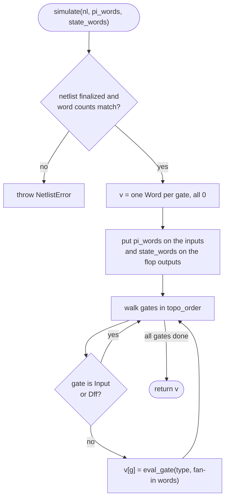
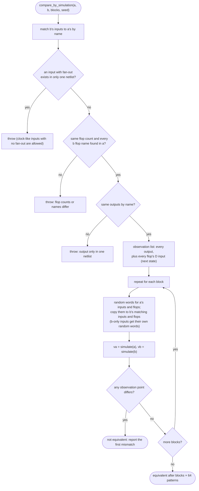

# Logic simulation

Files: `include/rith/sim.hpp`, `src/sim.cpp`

[Back to the index](../README.md) · [Architecture](../architecture.md)

## What it is for

Two jobs:

1. `simulate()` works out the value on every net for a block of 64 patterns at
   once (one bit per pattern), in the full-scan view.
2. `compare_by_simulation()` checks whether two netlists behave the same, by
   feeding both the same random patterns and comparing outputs and flop next states.
   `rith equiv` uses it.

## `simulate()`

Because gates are visited in level order, every fan-in value is ready before the
gate that reads it. The value of a flop's D input (`v[fanins(flop)[0]]`) is the
flop's **next state**.

## `compare_by_simulation()`

`EquivalenceOptions` adds two things for comparing scanned netlists. `tie` holds an
input at 0 or 1 in whichever netlist has it (for example `SE` off for mission mode);
`ignore` names ports that may exist in only one netlist: such an input gets random
values, and an output named there is not compared. A tied or ignored input may exist
in only one netlist even if it has fan-out.

This finds most real differences quickly, but it is a random check, not a formal
proof. Flops are matched by name, so both netlists must use the same flop names.
