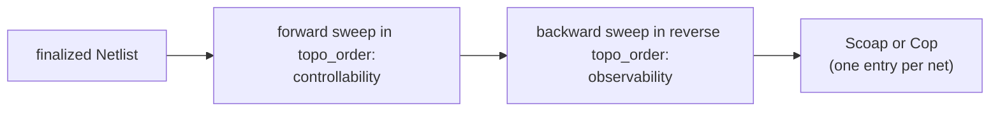
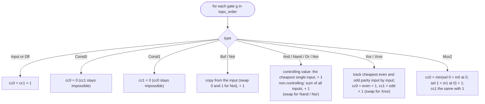
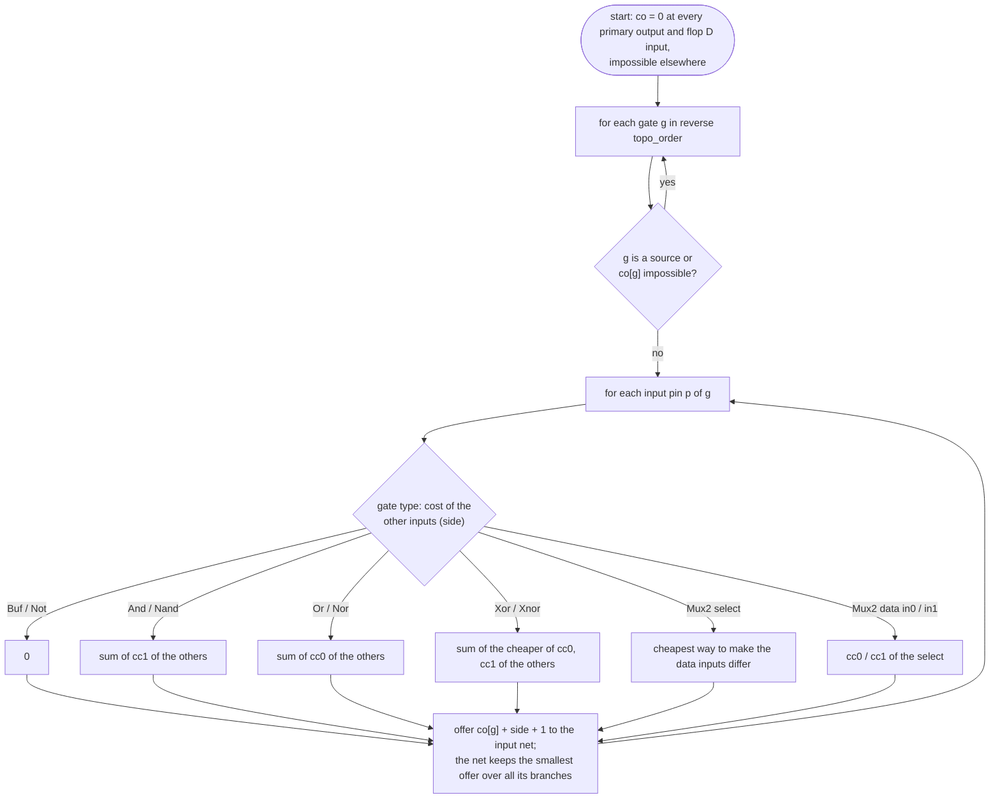
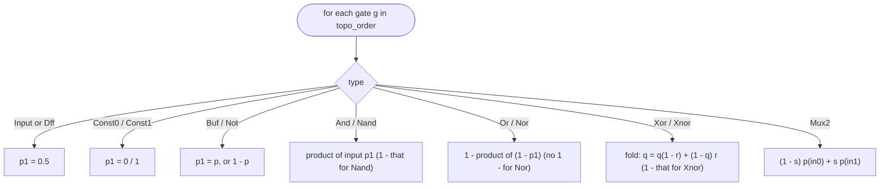
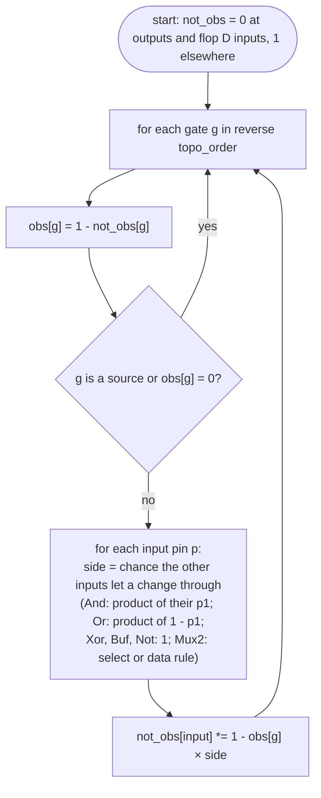

# Testability: SCOAP and COP

Files: `include/rith/testability.hpp`, `src/testability.cpp`

[Back to the index](../README.md) · [Architecture](../architecture.md)

## What it is for

Before simulating any faults, you can estimate how hard each net is to test just by
looking at the circuit's structure. Both measures here do that in two sweeps:

- a **forward** sweep (inputs to outputs) for *controllability*: how hard is it to
  make this net 0 or 1?
- a **backward** sweep (outputs to inputs) for *observability*: how hard is it to see
  this net at an output?

Both use the full-scan view: flops count as inputs (their Q) and as outputs (their D).

| Measure | Per net | Meaning | Good value |
|---|---|---|---|
| SCOAP `cc0`, `cc1` | integer | effort to set the net to 0 / 1 | small |
| SCOAP `co` | integer | effort to see the net | small (0 at an output) |
| COP `p1` | probability | chance the net is 1 under random inputs | near 0.5 |
| COP `obs` | probability | chance a change on the net reaches an output | near 1 |

COP also gives the chance a random pattern detects a stem fault:
`detect_sa0 = p1 × obs` and `detect_sa1 = (1 − p1) × obs`. `rith testability` sorts
nets by the smaller of the two to list the hardest ones. These numbers are also the
features and the baseline for [test point insertion](tpi.md).

## Overall flow

## SCOAP (`compute_scoap`)

Numbers are capped at `kScoapInf` (2^30), which means "impossible".

### Forward: controllability

Example for AND: to get a 0 you only need one input at 0 (take the cheapest); to get
a 1 you need all inputs at 1 (add them up).

### Backward: observability

## COP (`compute_cop`)

### Forward: probability of 1

Inputs are treated as independent. That is exact for trees but only an estimate
where a signal splits and later rejoins (reconvergent fan-out). This is why TPI
re-checks its choices with real fault simulation.

### Backward: observability

A net that feeds several gates is seen if *any* branch sees it. Treating the
branches as independent gives `obs(stem) = 1 − Π(1 − obs(branch))`, which is the
running product `not_obs`.
