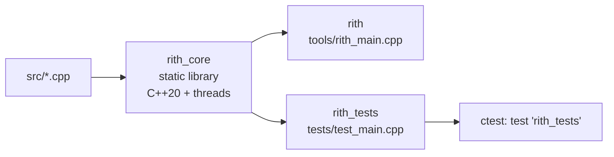
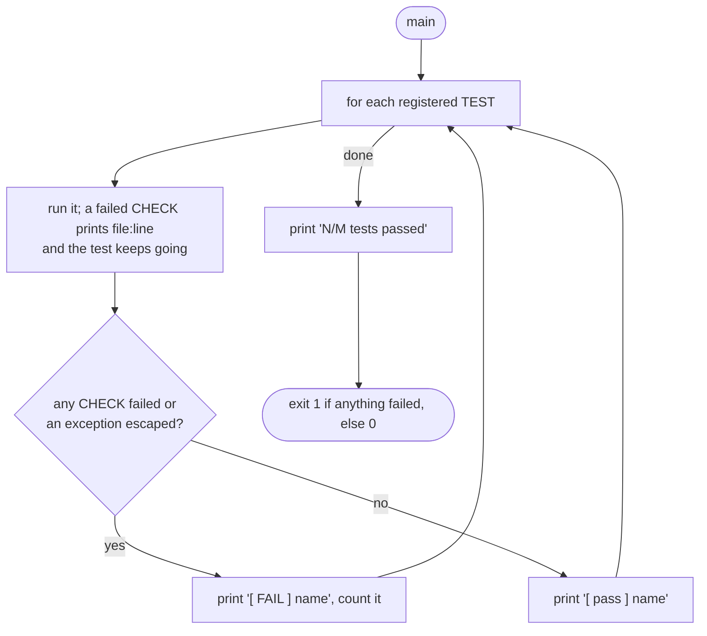
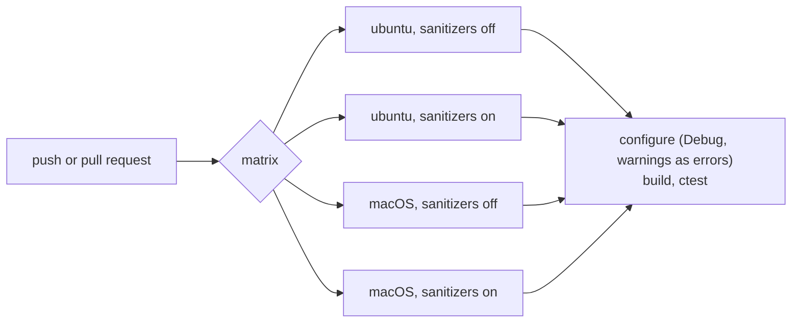

# Tests and continuous integration

Files: `tests/test_main.cpp`, `tests/data/`, `CMakeLists.txt`, `.github/workflows/ci.yml`

[Back to the index](../README.md) · [Architecture](../architecture.md)

## Build targets (`CMakeLists.txt`)

Options: `RITH_WERROR` (warnings are errors) and `RITH_SANITIZE` (address and
undefined-behaviour sanitizers). The test program gets the path of `tests/data` as
`RITH_TEST_DATA`.

## How the test program works

`test_main.cpp` has its own tiny test framework (no outside library). A
`TEST(name)` macro registers a function in a list; `main()` runs them all.
`CHECK(cond)` records a failure without stopping the test, and
`CHECK_THROWS(expr, text)` checks that an error is thrown and its message contains
`text`.

## What is tested

| Area | Tests | Data |
|---|---|---|
| Netlist core and simulation | `c17_structure`, `c17_exhaustive_simulation`, `s27_flops_are_cut` | `c17.bench`, `s27.bench` |
| Readers and writers | `bench_verilog_roundtrip_is_equivalent`, `verilog_writer_is_idempotent`, `yosys_generic_cells`, `verilog_primitives_and_constants`, `verilog_to_bench_roundtrip`, `escaped_identifiers`, `errors_are_reported`, `bench_repeated_output_is_ignored` | `yosys_small.v`, `small_ref.bench`, `primitives.v` |
| Equivalence check | `equivalence_finds_a_bug` | |
| Liberty and mapped netlists | `liberty_cells`, `liberty_function_precedence`, `design_compiler_style_netlist`, `liberty_errors` | `tiny.lib`, `dc_style.v`, `dc_style_ref.bench` |
| Fault list and fault simulation | `c17_fault_list`, `fault_simulator_matches_brute_force`, `collapsed_faults_are_really_equivalent`, `c17_reaches_full_coverage`, `random_patterns_and_redundant_fault`, `unobservable_logic_is_left_out`, `multithreaded_fault_simulation_is_deterministic` | |
| SCOAP and COP | `scoap_c17`, `scoap_flops_and_constants`, `cop_matches_exhaustive_probability` | |
| Design view | `design_roundtrip_keeps_cells_and_buses` | |
| Scan insertion | `scan_cells_are_found_by_function`, `scan_insertion_dc_style`, `scan_insertion_clock_domains`, `scan_chain_count_and_balance`, `scan_checks_catch_a_broken_chain`, `scan_outputs` | `scan_domains.v`, `tiny.lib` |
| Test point insertion | `tpi_cop_matches_the_inserted_logic`, `tpi_raises_random_pattern_coverage`, `tpi_skips_dead_logic`, `tpi_fixed_inputs_hold_their_value`, `tpi_design_insertion_keeps_mission_mode` | |
| ATPG | `podem_matches_brute_force_on_benchmarks`, `podem_matches_brute_force_on_random_circuits`, `learned_implications_are_true`, `podem_decides_only_on_inputs_and_traces`, `atpg_flow_on_benchmarks` | `c17.bench`, `s27.bench`, 150 generated circuits |

Several tests compare a fast method with a slow, obviously correct one: the fault
simulator against brute-force simulation of each fault, COP against exhaustive
probability, collapsed faults against simulation of every member of the class, and
the virtual COP with test points against COP of the netlist with the points really
built, and PODEM against brute force over every input assignment.

## CI (`.github/workflows/ci.yml`)

On every push and pull request, GitHub Actions builds and tests on four
combinations:

