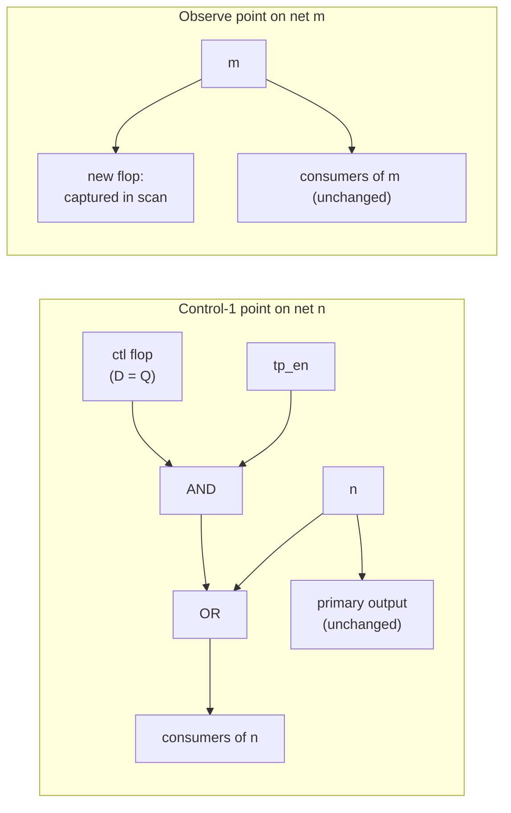
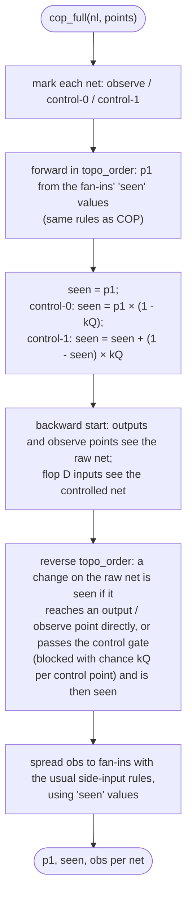
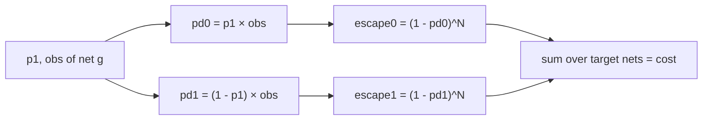
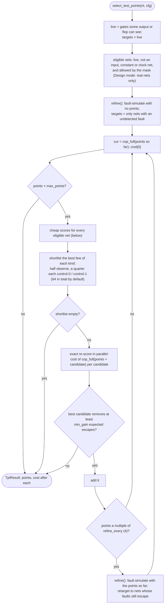
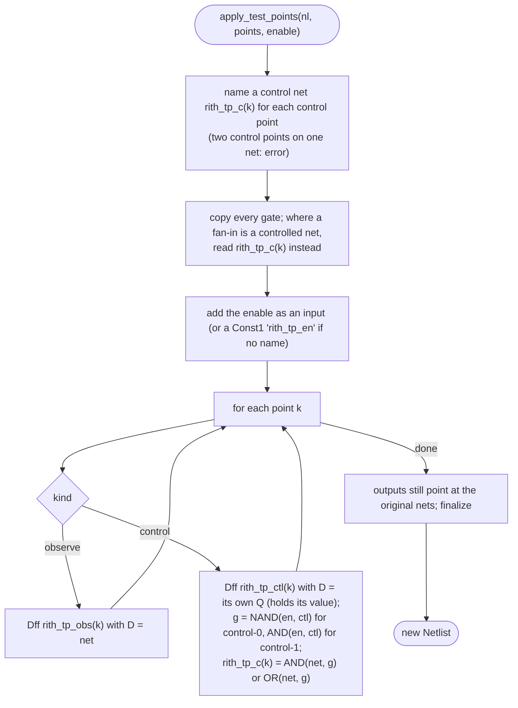
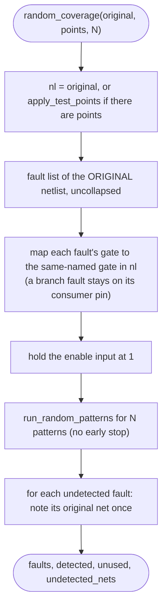
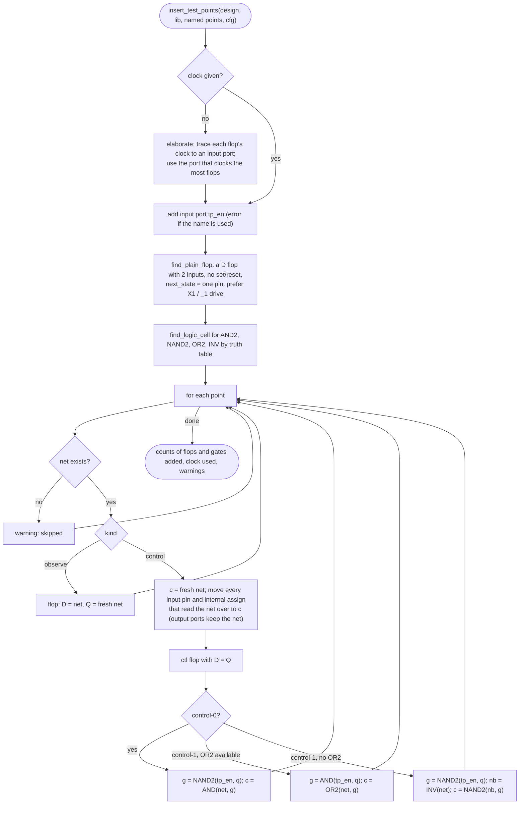

# Test point insertion (TPI)

Files: `include/rith/tpi.hpp`, `src/tpi.cpp`

[Back to the index](../README.md) · [Architecture](../architecture.md)

## What it is for

Some faults are very hard to detect with random patterns: a net that is almost
always 1, or a net whose changes almost never reach an output. A **test point** is a
little extra logic that fixes that during test, and does nothing in mission mode.

| Kind | Added hardware | Effect during test (`tp_en` = 1) |
|---|---|---|
| Observe | a new flop that captures the net | faults behind the net become visible at that flop |
| Control-0 | `net AND NOT(tp_en AND ctl)` | consumers see the net forced to 0 when the point's flop `ctl` holds 1 |
| Control-1 | `net OR (tp_en AND ctl)` | consumers see the net forced to 1 when `ctl` holds 1 |

`ctl` is a new flop that just holds the value scanned into it. `tp_en` is a new input
that is 0 in mission mode. Primary outputs keep reading the *original* net, so with
`tp_en = 0` the design behaves exactly as before.

The module has three jobs:

1. **Choose** points on a `Netlist` (`select_test_points`), the classic baseline.
2. **Measure** coverage with and without them (`apply_test_points`, `random_coverage`).
3. **Insert** them into a mapped `Design` with real library cells (`insert_test_points`).

## COP with test points (`cop_full`)

The selector needs to know how a test point would change COP numbers without really
building it. `cop_full` is the [COP](testability.md) calculation with test points
applied virtually. Each control point is active with probability `kQ = 0.5`.

It keeps three values per net:

- `p1`: chance the original net is 1;
- `seen`: chance its consumers see 1 (after a control point, if any);
- `obs`: chance a change on the original net is observed.

## The cost the selector minimises

For each stem fault the chance one random pattern detects it is
`pd = p1 × obs` (SA0) or `(1 − p1) × obs` (SA1). After `N` patterns the chance it is
still undetected is `(1 − pd)^N`. The cost is the sum of that over all target nets:
the **expected number of faults that escape** `N` random patterns.

`escape()` computes `(1 − pd)^N` as `exp(N × log1p(−pd))` so tiny probabilities do not
round to zero.

## Choosing points (`select_test_points`)

A greedy loop: each round, find the single best point to add, add it, repeat.

**Cheap scores** (quick guesses used only to build the shortlist):

- *Observe at g*: the escapes g would lose if fully observed, plus half of each
  fan-in's escapes scaled by how poorly that fan-in is observed now.
- *Control-0 at g*: the escapes of g's gate consumers × chance g is 1 now (forcing 0
  helps most when the net is usually 1).
- *Control-1 at g*: the same × chance g is 0 now.

**Why refine?** COP treats signals as independent, which is wrong where a signal
splits and later rejoins. It can then aim points at nets whose faults are in fact
already detected. Every 4 points, a real fault simulation (`random_coverage`) shows
which nets really have escaping faults, and the cost is aimed only at those.
`--cop-only` (`refine_every = 0`) turns this off.

## Building test points as gates (`apply_test_points`)

Used to measure coverage, and by `rith tpi -o` on a BENCH netlist.

New flops use the clock of the first clocked flop in the netlist.

## Measuring coverage (`random_coverage`)

Measuring over the original logic's faults means "before" and "after" count exactly
the same faults; faults inside the new test logic are not counted.

## Inserting into a mapped design (`insert_test_points`)

`AND` here is an AND2 cell if the library has one, else NAND2 followed by INV. The
new flops are plain D flops; running `rith scan` afterwards turns them into scan
flops and puts them on chains.
